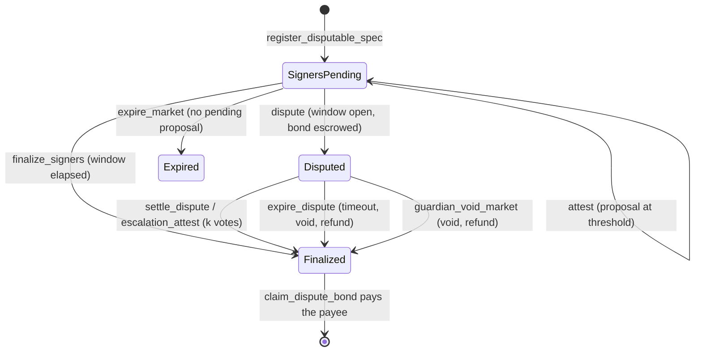

# Architecture

See the top-level diagram in [README.md](../README.md#architecture) for the
system at a glance. This doc goes one level deeper into each contract's
responsibilities and the invariants that hold across them.

## Contracts

### market-core

The hub: every binary market lives here as one entry in persistent storage,
keyed by `market_id`. Pricing is a Gnosis-style constant-product FPMM over
internal YES/NO share accounting — no external LP token, no AMM pool
contract per market. `contracts/market-core/src/math.rs` is the entire
pricing engine, pure integer arithmetic, no `Env` dependency, so it's
natively unit-testable and mirrored line-for-line in
[`model/fpmm_model.py`](../model/fpmm_model.py) and
`agents/core/fpmm.ts` for property testing and off-chain quoting.

**Solvency invariant** (holds after every state transition — see the test
suite for the ones exercised): the contract's own SEP-41 token balance for a
market equals `sets_minted + fees_accrued + lp_fees` (`fees_accrued` is the
protocol's pending share of trading fees, `lp_fees` the creator's — see the
fee split below), and `reserve_yes + Σ(user yes positions) == sets_minted`
(symmetrically for `no`).

**Fee split and recipient snapshot.** `create_market` snapshots a
`FeeTerms { recipient, protocol_share_bps }` side entry per market, so
`propose_treasury` / `set_protocol_fee_share_bps` only affect markets created
after them. Each trade's fee is split once at accrual time
(`math::split_fee`, protocol shares round up so `protocol + lp == fee`
exactly): the protocol portion accumulates in `Market.fees_accrued` and is
swept to the snapshotted recipient by the permissionless `sweep_fees`
(old `FeesSwept` event kept for indexers, plus `FeesSweptTo`); the creator
portion accumulates in a `LpFees(market_id)` side entry, claimable any time
(before finality too) via `claim_lp_fees`, and also drained by
`claim_pool_remainder`. Markets created before this change have no
`FeeTerms` entry and fall back to the old behavior: recipient = whatever
`DataKey::Treasury` holds at sweep time, `protocol_share_bps = 10_000` —
fully backward compatible, no migration transaction needed. The separate
LP balance (rather than adding fees to the reserves) is deliberate: it does
not move `k` or the price and maps directly onto the per-LP fee accumulator
of the future multi-LP design ([wave-issue 02](wave-issues/02-multi-lp-liquidity.md)).

**Trade bounds and circuit breakers.** Two layers of protection beyond the
share-count slippage parameters:

- *Deadline + limit price* (#12): `buy_v2` / `sell_v2` take a
  `deadline` (ledger **timestamp**, unix seconds) checked before anything
  else, and a `limit_price_bps` bounding the **average execution price**
  (`collateral_in / shares_out` for buys, `collateral_out / shares_in` for
  sells, fee included, compared by cross-multiplication). `0` means "no
  limit" for buys; for sells it is trivially satisfied and buys no
  protection. The original `buy` / `sell` remain as thin wrappers for
  backward compatibility (same body, no bounds).
- *Per-market breakers* (#10): `BreakerConfig { max_impact_bps, band_bps }`
  is snapshotted per market from an admin default (`set_default_breaker`,
  which rejects `band_bps < max_impact_bps` because that makes one trade
  cover the whole band). `max_impact_bps` bounds a single trade's
  |post − pre| YES-price move (`>` — a trade moving exactly the cap
  passes); `band_bps` bounds |post − ledger-open price|, with the reference
  stored in short-TTL **temporary** storage keyed by ledger sequence, so it
  resets by itself every ledger. 0 disables either check; legacy markets
  have no config and are unaffected. Breaker trips revert with
  `PriceImpactTooHigh` / `PriceBandExceeded` and — because Soroban rolls
  back an invocation's events on `Err` — emit **no** event (the error codes
  and the `would_trip` / `breaker_config` / `breaker_state` views are the
  observability path; see the comment on `check_breakers`).

  *Worst-case lock cost.* The band cannot be ratcheted: the reference is
  the ledger-open price, so an attacker who pushes the price to the band
  edge only blocks further trades for the rest of that ledger (~5 s) —
  and pays the trading fee plus price impact to do it, which arbitrageurs
  can take back the next ledger. The breakers cannot lock a market across
  ledgers by construction.

**Transferability.** `transfer_position(from, to, market_id, outcome,
amount)` moves shares between any two addresses (owner auth; allowed while
`Paused` — a transfer moves no collateral — and after finality until
`redeem`), rejecting self-transfers, transfers to the contract's own
address (they could never be redeemed) and over-transfers, and emitting
`PositionTransferred` so indexers stay in sync. `transfer_lp(market_id,
new_creator)` (current-creator auth, until `lp_claimed`) moves the single
LP role — the right to `claim_pool_remainder` and `claim_lp_fees` — and
emits `LpTransferred`. Both preserve the solvency invariant by
construction; the position mapping is unchanged down to the "remove
zero entries" rule.

**Resolution commitment**: `resolution_hash` is fixed at `create_market`
time — see [ADR 0001](adr/0001-resolution-commitment.md) for why.

Lifecycle: `create_market` → `buy`/`sell` (while open; `buy_v2`/`sell_v2`
with bounds) → `resolve` or `void_market` (resolver-only) → `redeem` per
holder, `claim_pool_remainder` for the creator/LP, `sweep_fees`
(permissionless) to the snapshotted fee recipient. Positions and LP
ownership can change hands at any point via `transfer_position` /
`transfer_lp`.

### resolver

Independent resolution modes, all ultimately calling
`market_core.resolve(market_id, outcome)`:

- **PriceThreshold**: reads a [Reflector](https://reflector.network) SEP-40
  price feed at (or after) the market's `close_time`, compares to a
  threshold, enforces a max staleness window. Anyone may first pin that
  read with `snapshot_price` (see "Oracle history retention" below).
- **Attested**: m-of-n signer votes on a resolver-local
  `AttestedOutcome { Yes, No, Invalid }`; once `threshold` signers agree, a
  dispute window opens; anyone can finalize after it elapses, or a guardian
  (the resolver's `admin`) can `cancel_proposal` during the window.
  Finalizing `Yes`/`No` calls market-core's `resolve`; finalizing `Invalid`
  calls `void_market` (every share redeems at 0.5) and emits
  `CommitteeVoided`, so signers who agree a question is unanswerable no
  longer need the guardian to void it. market-core's `Outcome` is
  unchanged. Each outcome has its own counter and signers are deduplicated
  per `(outcome, signer)`; the first outcome to reach threshold is
  proposed and later `Yes`/`No` quorums never move it, except that an
  `Invalid` quorum replaces a pending `Yes`/`No` proposal and restarts the
  dispute window. `attest` requires `close_time` to have passed, which is
  what keeps a committee void (market-core's `void_market` has no close-time
  guard) from happening early. Proposals and finalizations emit
  `ResolutionProposedV2` / `ResolutionFinalizedV2` (carrying
  `AttestedOutcome`); the old `Outcome`-typed events are no longer
  emitted. Storage keys are versioned (`AttestationV2`, `CountV2`,
  `ProposalV2`); see ADR 0003 for the redeploy runbook and the legacy-key
  fallback.
- **Weighted keys**: a committee of raw Ed25519 public keys with weights.
  Members sign a domain-separated message off-chain and anyone submits the
  signatures to `submit_signatures` in one transaction; the weight threshold
  starts the same dispute window. `cancel_proposal` moves the market to a new
  round, invalidating earlier signatures. Message format: ADR 0001.
- **Committee with time-locked key rotation** (#35): binds resolution to a
  reusable committee registry rather than raw addresses. The admin can propose
  membership and threshold rotations with a mandatory delay (`rotation_delay >= 86_400`).
  Markets commit to `(committee_id, min_epoch, max_rotation_delta, dispute_window)`.
  Votes are checked and recounted against the committee members active at the current epoch.
- **Hybrid (price feed with attested fallback)** (#36): commits to a Reflector
  price rule and a fallback signer set. If the oracle feed fails or is unavailable
  after `close_time + fallback_delay`, anyone can call `open_fallback(market_id)` to
  allow fallback signers to propose and attest. If a valid price report arrives before
  the fallback dispute window closes, `resolve_price` immediately supersedes the proposal
  and resolves the market.

None of these modes can be configured until the revealed spec's hash matches the
market's commitment (`register_price_spec`, `register_signer_spec`,
`register_committee_spec`, or `register_hybrid_spec` — see ADR 0001).
A guardian can also `guardian_void_market` an unresolvable market directly,
subject to time windows and typed audit reasons.

#### Oracle history retention

SEP-40 oracles, Reflector included, keep a bounded history: records are
published at a fixed cadence (the feed's `resolution()`) and only a fixed
number of recent ones are retained, so `price(asset, timestamp)` returns
`None` once `timestamp` falls outside that window. Look the current values
up from Reflector's documentation or the feed contract itself; do not
assume them. A price market nobody resolves before its `close_time` record
ages out would otherwise return `PriceUnavailable` forever and could only be
voided.

`snapshot_price(market_id, caller)` closes that gap. Anyone may call it
after `close_time` while the market is unresolved; it reads the committed
feed exactly as resolution does, validates it with the same rule
(`validate_price`: not after close, no older than `max_staleness`), and
stores it as a `PriceSnapshot`. An invalid read is never stored, and the
first valid snapshot wins (`SnapshotExists`): the answer for a fixed
`(asset, close_time)` is deterministic, so this deliberately prefers
determinism over an oracle later rewriting history. Every price path
(`resolve_price`, `expire_market`, `open_fallback`, and the guardian's
`OracleUnavailable` check) uses a stored snapshot before the live feed and
then skips the oracle call. `PriceResolutionV2` adds `from_snapshot`; the
original `PriceResolution` is still emitted alongside it for one release.

Operators and agents should call `snapshot_price` within one oracle period
of `close_time` (CLI: `stellar contract invoke --id $RESOLVER -- snapshot_price
--market_id <id> --caller <address>`). A late snapshot is still accepted as
long as the oracle has the record.

#### Bonded disputes (`SignersDisputable`)

A `SignersDisputable` spec adds an optimistic challenge to Attested mode.
While a proposal's dispute window is open, anyone can `dispute` it by
escrowing `dispute_bond` of the collateral token in the resolver. That
freezes `finalize_signers`, `attest`, `cancel_proposal` and `expire_market`
(`DisputeActive`) and escalates to the authority committed in the spec: the
guardian (`settle_dispute`) or a `k`-of-`n` committee disjoint from the
signers (`escalation_attest`). Upholding the proposal resolves to it and
forfeits the bond to market-core's treasury; any other ruling resolves to the
verdict (or voids for `Invalid`) and returns the bond. If nobody rules within
`escalation_timeout` of the dispute, anyone may `expire_dispute`: the market is
voided and the bond refunded. `guardian_void_market` during a dispute also
refunds it. Bonds leave escrow only via the permissionless
`claim_dispute_bond` (pull, so a payee that cannot receive cannot block
settlement); the resolver's token balance always equals the bonds it still
holds.

**Rewards, honestly:** a winning disputer only gets their bond back. The
resolver holds no funds besides bonds, so there is nothing to pay a reward
from until signers also post bonds (signer staking is separate work). The
incentive to dispute is therefore protecting one's own position, not profit.

Liveness: `resolution_deadline` is `close_time` + 30 days. After it anyone can
call `expire_market`, which resolves the market if it still can be (valid
price feed) and otherwise voids it through market-core, so collateral is never
locked behind a missing reveal or a silent committee. See ADR 0001.

#### Attestation evidence linking (`reasoning-registry`)

Attestation votes can be bound to cryptographic traces recorded in `reasoning-registry`.
When configured via `set_evidence_config(min_policy, registry)`:
- Signers call `attest_with_evidence` citing `(trace_hash, reasoning_hash)`.
- The resolver queries `reasoning-registry` via cross-contract call to confirm that
  the trace has been published and satisfies `EvidencePolicy` (e.g. `RawBytes` vs `ReasoningBounded`).
- Each `trace_hash` can only be cited once per market (`EvidenceUsed` prevents replay).
- An audit trail of cited traces is preserved on-chain (`evidence_count`, `evidence_at`).

#### Constrained guardian powers and audit trail

To limit administrative discretion:
- **Dispute window bounds**: `cancel_proposal` can only be executed while a dispute window
  is actively open (`DisputeWindowClosed` error if closed).
- **Grace periods for voiding**: `guardian_void_market` cannot void arbitrarily; it requires
  `close_time + REVEAL_GRACE_SECS` (3 days) for unrevealed specs, `close_time + ORACLE_GRACE_SECS`
  (1 day) for failing price feeds, and `close_time + SIGNER_GRACE_SECS` (7 days) for unresponsive
  signers (`GracePeriodNotElapsed` error if called early).
- **Rate limiting**: `MAX_CANCELS_PER_MARKET = 2` prevents infinite cancellation griefing.
- **Audit trail**: Every guardian cancellation or void requires a typed `GuardianReason`
  (`StaleOracleFeed`, `CompromisedSigner`, `AmbiguousSpec`, `LivenessFailure`, `Other`),
  and emits a `GuardianAction` event with full contextual metadata.

The resolver never depends on `market-core`'s Rust crate — see
[ADR 0002](adr/0002-cross-contract-calls.md) for why, and what that trades
off.

### treasury

Holds the agents' pooled USDC and is the *only* path that spends it: an
agent calls `agent_create_market` / `agent_buy` / `agent_sell` /
`agent_buy_v2` / `agent_sell_v2` (always naming itself as the first
`agent` argument), the treasury checks the agent's role and its own
per-trade/per-market/daily caps plus the price limits, then calls
`market-core` itself as the trader/creator. This means the caps are a real on-chain limit on what the
automated agent can deploy — an agent's own key calling `market-core`
directly would just be trading its own separate funds, not bypassing a cap
on the treasury's money. The `*_v2` twins forward the same caps plus
market-core's deadline / limit-price bounds, so a revert from either layer
leaves the caps unchanged (the whole invocation is atomic).

**Agents.** The treasury keeps a registry of up to `MAX_AGENTS = 16` agents,
each with an `AgentPolicy { roles, max_trade, max_daily, active }`. Roles are
a bitmask: `ROLE_CREATE` (`agent_create_market`), `ROLE_TRADE` (`agent_buy`,
`agent_sell` and their `_v2` twins) and `ROLE_SETTLE` (`redeem`,
`claim_pool_remainder`, `close_trade`, `agent_claim_lp_fees`, the `legacy_*`
recovery calls). The constructor registers its `agent` with every role and
the global caps; `scripts/deploy-testnet.sh` then proposes a separate maker
(`CREATE | SETTLE`) and trader (`TRADE | SETTLE`), so a leaked trader key
cannot create markets and a runaway trader cannot spend the maker's budget.
An agent's `max_trade` and `max_daily` sit under the global caps; both levels
are checked on every spend, and each agent has its own sliding daily window
(`agent_daily_usage`). `TradeAuthorized.agent` names the acting agent.
Positions are still pooled: market-core only ever sees the treasury, so the
per-agent state is usage, not ownership. `remove_agent` deactivates at once
(usage history kept), but at least one active `ROLE_SETTLE` agent must always
remain so open positions can be settled. Narrowing an active agent's policy
applies at once; adding, reactivating or widening one goes through the
timelock below (`set_agent` → `execute_agent` after `config_delay`).
`get_config()` survives as a deprecated view in the old `RiskConfig` shape,
whose `agent` is the first registered agent; a stored pre-registry config is
migrated lazily into `GlobalConfig` plus one full-role agent.

**Caps.** Four limits apply to every buy and market creation:

- `max_trade`: per call.
- `max_market`: lifetime capital ever committed to one market. Never freed,
  not by sells, redemptions or `close_trade`.
- `max_daily`: a **sliding** 24h limit. Usage is kept in 25 hourly buckets
  (`UsageWindow`, instance storage); a trade at hour `h` is accepted only if
  buckets `h-24 ..= h` plus the trade stay within `max_daily`. Every real
  24h interval falls inside those 25 hours, so no trailing 24h ever exceeds
  the cap. The rounding is conservative: a trade keeps counting for 24-25h.
  (The previous fixed window reset lazily, so `max_daily` could be spent
  just before a reset and again just after it.) `daily_usage()` keeps its
  `DailyUsage` shape (`day_start` is now the start of the oldest counted
  hour) and is side-effect free; `daily_usage_detail()` returns the buckets
  and `daily_headroom()` the remaining allowance.
- `max_net_exposure`: capital *currently* deployed across all markets. The
  treasury records collateral in (buys, creations) and out (sells,
  redemptions, pool remainders, LP fee claims) per market (`NetPosition`)
  and keeps a running `net_exposure() = sum(max(0, in - out))`. Profit in
  one market floors at zero and never offsets another. A sell frees net
  headroom but not lifetime headroom; `close_trade` changes neither;
  `migrate_market` drops the market from net accounting. Enforcement uses
  only these local counters (no extra cross-contract call on the hot path)
  and never a pool price: a spot-valued cap would let anyone pump a price to
  unlock headroom or crash it to block the agent. `market_valuation(id)`
  reports `cost_basis`, a manipulation-resistant `floor_value` (complete
  sets `min(yes, no)` plus `min(reserve_yes, reserve_no)` as unclaimed LP;
  the settlement value once final), an informational `spot_value`, and
  `at_risk = max(0, cost_basis - floor_value)`. Net accounting starts when
  the contract is deployed (missing entries read as zero). The treasury's
creator-side claims are split the same way the fees are: `collect_market_fees`
sweeps the **protocol portion** to the treasury, while `agent_claim_lp_fees`
claims the LP portion for markets the treasury created.

**Price limits.** Size caps do not stop the treasury buying YES at 99% in a
pool that was at 40% a moment ago (a buggy strategy, a compromised agent key,
a sandwich). A `PricePolicy { max_buy_price_bps, min_sell_price_bps,
max_impact_bps, max_slippage_bps }` (defaults 9500 / 500 / 500 / 200) is
enforced inside every agent trade, using market-core's own `get_price` so the
rounding matches what clients see:

- buys need the outcome's spot price `<= max_buy_price_bps`, sells need it
  `>= min_sell_price_bps`; `agent_create_market` needs `initial_yes_bps`
  within `[min_sell, max_buy]`;
- `min_shares_out` is raised to the same-transaction `quote_buy` minus
  `max_slippage_bps` (never below 1), and `max_shares_in` is capped at
  `quote_sell` plus `max_slippage_bps` (rounded up);
- after the trade, `|p_after - p_before| <= max_impact_bps`.

Because the quote runs against the same pool state as the trade, the quote
floor only protects the agent's own intent; the band is what stops a
front-runner (pushing the price out of band fails the trade), and the impact
limit bounds how far any single trade moves the pool. Large trades in thin
pools are rejected by the impact limit, so strategies must split them;
`max_trade` and `max_impact_bps` interact. market-core's `SlippageExceeded`
is remapped to the treasury's own `SlippageExceeded = 27`; other market-core
errors are re-raised with market-core's codes, which overlap the treasury's
numerically. The checks add three cross-contract view calls per trade: a
1 USDC `agent_buy` against a real market-core measured ~3.5M instructions in
`price_checks_cost_estimate_recorded`.

**Timelocked configuration.** The global caps (`GlobalConfig`: collateral,
market_core, `max_trade`, `max_market`, `max_daily`, `max_net_exposure`), the
price policy and agent policies change through propose/execute with
asymmetric rules: anything that only tightens (lower caps, a narrower band,
fewer roles) applies immediately; anything that loosens (any raised cap, a
new or widened agent, a changed collateral or market-core) waits
`config_delay` (at least one day, set at construction, can only grow via
`set_config_delay`) and is announced first by `ConfigProposed` /
`AgentPolicyProposed` / `PricePolicyProposed`. A proposal that lowers one
value and raises another is a loosening as a whole; split it to apply the
tightening at once. Execution (`execute_config`, `execute_agent`,
`execute_price_policy`) is permissionless once due, so it never depends on the
admin; `cancel_*` is admin-only. A tightening applied while a loosening is
pending leaves that proposal and its timer as they are. A collateral switch
is only allowed for an empty treasury (no balance, open markets or queued
withdrawals). A market-core switch leaves positions in the old core where they
are: the old core is recorded as legacy, `legacy_redeem` /
`legacy_claim_pool_remainder` recover them, and exposure for any later core
is kept under keys namespaced by core address (the original core keeps the
old `Market(id)` / `Net(id)` keys) so restarted market ids cannot collide.
The new core still needs its own `propose_treasury` handshake for fee sweeps.
This bounds
what a compromised admin can unlock *for the agents*; it is not a custody
control (see "Vault" and SECURITY.md).

**Vault.** Deposits mint internal shares against a conservative NAV and
withdrawals burn them; there is no admin `withdraw`. `nav() = idle +
Σ floor(open markets) - queue_reserved`, where an open market's floor is its
complete sets `min(yes, no)` plus `min(reserve_yes, reserve_no)` for an
unclaimed LP role, and a final market counts its exact settlement value. The
directional part of a position is valued at zero, so trading against a pool
cannot raise NAV. The open-market index walked by `nav()` is bounded at
`MAX_OPEN_MARKETS = 12` (two market-core reads each; 16 already used ~40 MB
of the 40 MiB per-transaction memory limit); a buy or creation in a 13th
market fails with `TooManyOpenMarkets`, and markets leave the index once
redeemed and claimed. Share math rounds toward the vault and uses a virtual
offset (1,000 shares / 1 stroop) plus dead shares on the first mint against
donation-based share inflation; deposits must be at least `MIN_DEPOSIT`
(10 USDC). `request_withdraw` prices the shares at once, pays what free idle
collateral allows and queues the remainder as a FIFO ticket;
`claim_withdraw(ticket)` (permissionless, pays the owner) settles the head
ticket as capital returns, and agents can never spend `queue_reserved()`.
While paused, `emergency_withdraw` pays shareholders their pro-rata part of
free idle collateral without touching market-core. See
[ADR 0005](adr/0005-treasury-vault.md).

**Migration to a successor treasury.** The treasury has no upgrade path, so
redeploying it (a bug fix, or anything the timelocked setters above do not
cover) means deploying a new contract. `set_successor(successor)`
(admin) records where value may go and emits `SuccessorSet`; then
`migrate_market(market_id)` (admin, **not** agent) moves the treasury's
YES/NO position and, if it is still the LP, its LP ownership for one market
to the successor — market by market, so the footprint stays bounded — and
emits `MarketMigrated`. The auth model:

- The agent has no path: both migration entrypoints are `require_admin`.
- The destination is fixed to the configured `Successor` — `migrate_market`
  takes no destination argument, so even a compromised agent key cannot
  redirect value. It is still an admin power over shareholders' capital:
  migrated positions leave this treasury's NAV without compensation, so a
  compromised admin could move them to a successor it controls. The
  successor is visible on-chain via `SuccessorSet` before any
  `migrate_market`, and SECURITY.md lists this as a known admin power.
- The treasury's calls to market-core's `transfer_position` / `transfer_lp`
  are *direct* calls, so market-core's `require_auth` on the treasury's own
  address is satisfied implicitly by the invoker rule — no
  `authorize_as_current_contract` entry is needed (unlike the nested token
  call in `authorize_token_pull`). This is proven by the
  `pitfall_migrate_market_needs_only_admin_auth` test, which permits only
  the admin's signature and no sub-invocations.

A migrated market's `MarketExposure` on the successor starts at zero and the
old treasury's entry is closed (`open = false`, amount preserved), so the
successor's caps apply to its own future activity — acceptable because the
cap is a per-deployment risk bound, not a market-level accounting value.
Successor-side acceptance (`accept_migration`) is deliberately not
implemented: it would record provenance only, and the events plus the
successor's own exposure records are enough for an off-chain dashboard
([wave-issue 08](wave-issues/08-treasury-exposure-dashboard.md)).

**Permissionless settlement & exposure release (#45).** Settle market capital
without depending on hot agent keys: `settle_market(caller, market_id)` is
permissionless and idempotent. It redeems the treasury's outcome-share position if
any, claims the LP remainder if the treasury created the market, marks market exposure
closed (`open = false`), and records realized proceeds under `Realized(market_id)`.
Calls to `market-core` use generated `try_` client methods so expected core errors
(`NothingToRedeem`, `AlreadyClaimed`, `NotFinal`) map cleanly to 0 or distinct treasury
errors without unhandled transaction aborts. Settlement operates even when the treasury
is paused (stopping trading, not fund recovery).

**Realized PnL & auto-pause on drawdown (#46).** Cumulative losses across markets
are bounded by an automated drawdown guard. The treasury tracks collateral cost
(buys and market seeds) and proceeds (sells, redemptions, LP remainders) per market
(`MarketPnl`). PnL is realized once a market is final and all positions/LP claims are settled
(or via permissionless `realize(market_id)` for pre-close exits). A rolling window of daily
buckets advances lazily, summing net realized PnL across `window_days`. If `window_pnl < -max_drawdown`,
the contract trips into drawdown pause (`DrawdownTripped` instance flag, emitting `DrawdownPause`).
In this mode, buys and creations are blocked, but `agent_sell` remains open (reduce-only) to avoid
trapping positions. Resuming requires admin `acknowledge_drawdown()` before unpausing. Third parties
triggering settlements cannot manipulate loss magnitude, only realization timing. Protocol fees and
external donations are strictly excluded from PnL accounting.

**Market-creation risk controls (#47).** Market seeds are decoupled from trade caps
via a dedicated `CreationPolicy` (max seed, rolling creation count limit, close horizon
bounds, allowed category bitmask). Stored in instance storage with bounded bucket arrays
(`CREATION_BUCKETS = 24`), creation limits are enforced before any cross-contract calls.
Admin policy updates are tighten-only (`set_creation_policy`), preventing a compromised key
from instantly loosening rules without a redeploy.

**Blend lending integration & JIT liquidity (#48).** Idle USDC can be supplied to a
configured Blend pool (`set_yield_venue`, `allocate_to_yield`, `recall_from_yield`) up to
`max_allocation` while preserving at least `max_daily` in liquid collateral. Spending entrypoints
(`agent_buy`, `agent_create_market`) use Just-In-Time liquidity (`ensure_liquid`): shortfalls in
liquid reserves trigger an atomic withdrawal from Blend within the same transaction. If pool
utilization prevents withdrawal, the trade reverts cleanly (`YieldWithdrawFailed`, fail-closed).
NAV views (`available_capital`) account for liquid plus supplied capital, alongside `capital_breakdown`.
See [ADR 0006](adr/0006-blend-integration.md).

The nested-authorization pitfall this design implies, and how it's handled,
is documented at length in `contracts/treasury/src/lib.rs` (see
`authorize_token_pull`) and exercised by
`pitfall_agent_buy_requires_treasury_self_authorization_for_nested_transfer`
in the same file's test module — a test that's been verified to fail
without the fix and pass with it (see the commit history / docs/STATUS.md).

### reasoning-registry

An admin allow-list of agent addresses; a registered agent calls
`publish_trace(agent, market_id, action, trace_hash, cid)` to record that a
trace exists, returning a `trace_id`. `verify_trace(trace_id, candidate_hash)`
is the check a paying subscriber (via `x402/`) or a frontend runs before
trusting fetched trace content. Traces are also indexed per market
(`market_trace_count` / `market_trace_at`) via a counter rather than an
unbounded `Vec`, so the index never has an unbounded-growth storage cost.

#### Agent Lifecycle and Trace Annotations (#56)

The reasoning registry models an explicit lifecycle for agents and traces:
- **Agent lifecycle**: Agents hold `AgentRecord { status: AgentStatus, registered_at: u64 }`.
  - `Active`: Registered agent permitted to publish traces.
  - `Retired(at)`: Agent gracefully retired by admin (`retire_agent`) or the agent itself (`retire_self`). Retired agents cannot publish new traces, but their existing traces remain valid. Admin may call `reactivate_agent` to return a retired agent to `Active`.
  - `Revoked(effective_from, reason)`: Agent revoked by admin (`revoke_agent`) due to compromise or malfeasance. Revocations cannot be reversed or reactivated, preventing history laundering.
- **Trace flagging**: The admin can annotate suspect traces via `flag_trace(trace_id, reason)` and `unflag_trace(trace_id, reason)`. Flags are annotations appended to a bounded history (max 16 entries) and never modify or erase the underlying trace data.
- **Trace verdict**: `trace_verdict(trace_id, received_hash)` evaluates validity in strict precedence:
  1. Not found -> `Err(TraceNotFound)`
  2. Hash differs -> `TraceVerdict::HashMismatch`
  3. Active flag -> `TraceVerdict::Flagged(reason)`
  4. Agent revoked with `trace.published_at >= effective_from` -> `TraceVerdict::AgentRevokedAfter(effective_from)`
  5. Otherwise -> `TraceVerdict::Valid`
- **Semantic tightening of `verify_trace`**: `verify_trace` returns `true` only if `trace_verdict` evaluates to `TraceVerdict::Valid`. Clients wishing to perform bare hash comparison without status checks can query `get_trace`.

#### Trace Action Validation and Market Reference Integrity (#55)

Traces reference concrete market actions validated against `market-core`:
- **Canonical Action Vocabulary**: `TraceAction` replaces free-form strings:
  | Action | Target Market | Description |
  | :--- | :--- | :--- |
  | `CreateMarket` | Issued `market_id` | Creation of a new market on-chain |
  | `ProposeMarket` | `NO_MARKET` (`u64::MAX`) | Off-chain market proposal prior to creation |
  | `Buy` | Issued `market_id` | Purchase of YES or NO shares |
  | `Sell` | Issued `market_id` | Sale of YES or NO shares |
  | `Skip` | Issued `market_id` | Evaluated market but took no trade action |
  | `Redeem` | Issued `market_id` | Redemption of winning or voided shares |
  | `ClaimRemainder` | Issued `market_id` | LP reclamation of unredeemed collateral pool |
  | `Resolve` | Issued `market_id` | Resolver or oracle resolution attestation |
  | `Other(Symbol)` | Issued `market_id` or `NO_MARKET` | Forward-compatible custom action; cannot shadow canonical action names |
- **Market Reference Validation**:
  - `market_core.market_count()` is checked via cross-contract read.
  - A referenced `market_id` must satisfy `market_id < market_count()`.
  - `ProposeMarket` requires `NO_MARKET` (`u64::MAX`), returning `Error::ProposalMustUseNoMarket` if given an actual `market_id`.
  - Canonical actions (`Buy`, `Sell`, etc.) reject `NO_MARKET` with `Error::MarketRequired`.
  - View function calls to `market_count()` remain functional even when `market-core` is paused.

#### Merkle-Batched Trace Anchoring (#54)

To slash per-decision publishing costs for high-frequency trading or extensive skip auditing:
- **Off-chain Batching**: Agents collect up to 4,096 trace hashes off-chain, compute a Merkle tree, and anchor the 32-byte root and manifest CID on-chain via `publish_trace_batch(agent, root, leaf_count, manifest_cid)`.
- **Cryptographic Specifications**:
  - **Second-Preimage Resistance**: RFC 6962 domain separation prefixes: leaves hash with `0x00 || trace_hash`, inner nodes hash with `0x01 || left || right`.
  - **Odd Node Promotion**: An odd child at any tree layer is promoted unchanged to the next level without duplicating or hashing with itself. When verifying an odd node, no proof element is consumed for that layer.
  - **Bounded Proof Length**: With `MAX_LEAVES = 4096`, proof length is strictly bounded to `MAX_PROOF_LEN = 12`. Any proof exceeding 12 elements is rejected with `Error::InvalidProof`.
- **Verification**: `verify_trace_inclusion(batch_id, trace_hash, index, proof)` and `compute_merkle_root(leaf_count, trace_hash, index, proof)` enable on-chain and off-chain (x402 verifier, agents) verification against canonical golden test vectors (`docs/vectors/merkle-v1.json`).

#### Ed25519-Signed Trace Attestations (#53)

To enable independent verification of trace authenticity without trusting the registry admin:
- **Dedicated Agent Signing Keys**: Agents bind dedicated Ed25519 public keys (`BytesN<32>`) to their on-chain identity via `add_signing_key(agent, public_key, proof_sig)`.
  - **Proof of Possession**: `proof_sig` proves ownership of the secret key by signing `"oracledesk-agent-key-v1" || network_id || registry_id || agent_xdr || public_key`.
  - **Key Binding & Lifecycle**: Keys are uniquely bound to agents (at most 4 active keys per agent) with full rotation history (`SigningKeyRecord { public_key, added_at, retired_at }`) tracked via `retire_signing_key`.
- **Domain-Separated Trace Attestation**: `publish_trace_signed(agent, market_id, action, trace_hash, ipfs_cid, signing_key, signature)`:
  - Message format: `"oracledesk-trace-v1" || network_id || registry_id || agent_xdr || market_id_be || action_tag || trace_hash`.
  - On-chain verification via `env.crypto().ed25519_verify`.
  - The attestation signature is stored under `TraceSignature(trace_id)` and queriable via `get_trace_signature` and `verify_trace_signature`.
- **Zero-Trust Offline Verification**: Any consumer holding the trace JSON and public key (e.g., an x402 subscriber or frontend auditor) can verify authenticity offline without RPC access or reliance on contract admin honesty.

**Known limitation**: Soroban RPC only retains a short window of historical
events. An indexer (Soroban events → Postgres, replayable) is required for
any UI that wants to list traces/trades older than that window — this is
one of the seeded `docs/wave-issues/`.

### router

A stateless address book (`RouterConfig { market_core, resolver,
reasoning_registry }`) plus atomic multi-step entrypoints, so a client cannot
half-apply a flow or point it at a hostile resolver (ADR 0009):
`create_and_reveal_signers` / `create_and_reveal_price` (create the market and
reveal its rule in one transaction; the commitment is computed locally from
the spec), `reveal_spec` (the deferred commit-now/reveal-later path), and
`buy_and_publish_trace` (buy through market-core and publish the reasoning
trace together, so a trade cannot drop its trace). It holds no funds and has
no admin.

### Governance: wiring, admin transfer, timelock

- **Authenticated wiring (ADR 0006).** `market-core` no longer lets the admin
  set the resolver/treasury directly. It `propose_resolver` /
  `propose_treasury`; the target must then prove, by calling back
  `market_core()`, that it is configured for this market-core before it takes
  the role. Every change emits `ResolverProposed`/`ResolverChanged` (and the
  treasury equivalents). Deploys are deterministic (`--salt`), so the real
  addresses are known before `market-core`'s constructor runs and there is no
  placeholder window.
- **Two-step admin transfer (ADR 0007).** All four core contracts (and the
  timelock) expose `propose_admin`/`accept_admin`/`cancel_admin_transfer` with
  a seven-day expiry. The new admin must accept, so a proposal to an address
  the operator does not control never lands; `new_admin` may be a classic
  multisig account, a smart-account multisig, or the timelock.
- **Timelock (ADR 0008).** `contracts/timelock` separates the proposer,
  canceller, executor and emergency roles and imposes a delay
  (`MIN_DELAY = 1 day`) between `schedule` and `execute`, with a seven-day
  execution grace and a `cancel` veto. `emergency` bypasses the delay for
  `set_paused(true)` / `cancel_proposal` only. Pointing the core contracts'
  admin at the timelock (deploy with `USE_TIMELOCK=1`, or migrate with
  `scripts/wire-timelock.sh`) removes any single key's ability to change a
  live market instantly.

## Off-chain pieces

- **x402/**: an Express service selling reasoning traces for ~$0.01 via
  `@x402/*`'s exact-payment Stellar scheme. Fetches the trace JSON (from
  IPFS or `reasoning-registry`'s configured store), recomputes its hash, and
  serves it only if the hash matches the on-chain record — see
  `x402/registry-trace-repository.ts`.
- **agents/**: `core/` is chain-agnostic (FPMM math including the
  price-impact quoting used to size trades under a breaker cap, trace
  building, strategy decisions with an optional impact clamp); `stellar/`
  is the only part that knows about Soroban, wrapping the generated
  bindings with a dry-run/live switch. The trader always quotes
  (`quote_buy`) immediately before submitting and derives non-zero
  `min_shares_out` / `limit_price_bps` bounds plus a deadline from it.
- **packages/bindings/**: generated TypeScript clients (`scripts/gen-bindings.sh`).

## Known limitations (see docs/STATUS.md for the full, current list)

- Testnet only; unaudited.
- No indexer yet — anything needing historical events beyond RPC's
  retention window has no on-chain-native way to query them.
- Agent-vs-agent liquidity: nothing here stops multiple independent agent
  deployments (this repo's or a fork's) from trading against the same
  market-core markets; the treasury's caps bound one agent deployment's own
  risk, not systemic market behavior.

## Void refund policies (#21)

`void_market` has always refunded every share at half a set (`Settlement::Void`,
floor division, so a void never overpays). That is the right default for a
question that turns out to be unanswerable *before anything is known*, but it is
the wrong number for a market voided after the event it described: a holder who
bought Yes at 90 cents on the dollar and is paid 50 has lost 40 to a decision
they had no part in. Markets may now choose which of the two they owe.

- `VoidPolicy { HalfPerShare, CostBasis }`, stored per market under
  `DataKey::VoidPolicy(u64)`. **Absent means `HalfPerShare`.** Every market
  created before this change, and every caller of `create_market`, is
  therefore bit-for-bit unchanged: no field was added to `Market` or `Position`,
  and `create_market`'s signature is untouched. A creator that wants the other
  policy calls `create_market_with_policy(...)`, which is the same entrypoint
  plus a trailing policy argument. Adding an optional trailing argument to
  `create_market` itself would have changed the XDR signature every consumer
  (including the sha256-pinned `market_core.wasm` vendored in resolver and
  treasury, and `packages/bindings`) decodes, so it is not what happened here.
- **Cost basis is a sidecar, not a field.** `DataKey::CostBasis(u64, Address)`
  holds one holder's signed net collateral flow into that market, and
  `DataKey::BasisTotal(u64)` holds the sum of the *positive* bases. Both are
  updated by the code paths that already move a position, and only when the
  market's policy is `CostBasis` (otherwise `add_basis`/`clear_basis` return
  immediately, so a `HalfPerShare` market never writes either key):

  | Path | Basis delta |
  | --- | --- |
  | creator seed (`create_market`) | `+seed_amount` |
  | `buy` / `buy_v2` | `+q.net` (collateral in, after fee) |
  | `sell` / `sell_v2` | `-q.gross` (collateral out, before fee) |
  | `transfer_position` | sliced from the sender, added to the receiver |
  | `redeem` | entry removed (the position is gone) |

  A **partial sell reduces basis by `q.gross`, not proportionally.** That is
  what keeps the global identity exact, because the pool's `sets_minted` drops
  by precisely the same `q.gross`. Consequence, and it looks wrong until you
  meet it: a holder who takes out more than they paid in — selling creator seed
  shares, or buying cheap and selling into a spike — carries a **negative**
  basis, and a negative basis refunds **0** at void even though the holder still
  holds shares. They kept their money out of the pool; the pool is not their
  counterparty. `get_cost_basis(market_id, holder)` exposes the number so nobody
  has to guess from a token balance.

- **The formula** is pure (`math::cost_basis_refund`), so it is testable without
  a chain:
  `refund_h = floor(basis_h * pot / basis_total)` clamped to
  `[0, basis_h]`, where `pot == m.sets_minted` at void time and `basis_total`
  sums only positive bases. The LP then receives
  `math::cost_basis_lp_residual(pot, basis_total) = pot − min(basis_total, pot)`.
  Together these pay `min(basis_total, pot)` to holders plus the remainder to
  the LP, exactly the pot: **`Σ holder payouts + LP residual ≤ sets_minted`**,
  which is the property the randomized Rust test
  (`cost_basis_void_solvent_under_random_sequences`) asserts over arbitrary
  buy/sell/transfer sequences.
- **Rounding and the dust bound.** Every holder payout floors, so no holder is
  ever overpaid and the pot can never be overdrawn. The shortfall is strictly
  less than one unit per holder with a positive basis — i.e. `< H` stroops for a
  market with `H` such holders — and it stays in the pool as the LP residual
  (it is included in `pot − min(basis_total, pot)`), not burned. A `pot` of 0
  pays nobody; a `basis_total` of 0 pays the LP the whole pot.
- **Order independence.** `void_market` freezes `VoidSnapshot { pot, basis_total }`
  once and emits `CostBasisVoidSnapshotted`. Every later `redeem` and
  `claim_pool_remainder` pays from that snapshot and never from live storage, so
  the order in which holders redeem cannot change anyone's amount (tested:
  A-B-C vs C-B-A). This matters because the *first* redemption of a void market
  would otherwise alter `basis_total` for the second.
- **Treasury note.** `reserve_capacity` and the treasury's own exposure
  accounting are unaffected — the void pot is the market's collateral either
  way. But a treasury `redeem` against a `CostBasis` market returns a different
  amount than against a `HalfPerShare` one, and treasury's
  `agent_create_market` keeps `HalfPerShare` (see `docs/STATUS.md`); switching
  an agent's markets over is a deliberate later decision, not a side effect of
  this change.

## Early close and the late-trade window (#22)

A "Will X happen by D?" market keeps trading until `D` even after `X` has
happened. Anyone faster than the repricing crowd buys the now-known outcome at a
stale price and the LP absorbs the difference; `resolve` could not help, because
it required `now >= close_time`. Trading may now end at the event instead of at
the deadline.

- **Effective close.** `effective_close = min(close_time, early_close)`, where
  `early_close` is `DataKey::EarlyClose(u64)` — an `Option<u64>` sidecar, absent
  for every market that was never halted. `assert_tradable` (so `buy`/`sell` and
  `buy_v2`/`sell_v2`), `resolve`, and the resolver's attestation gate all read
  through it; `close_time` itself remains the *nominal* close, because `Market`
  is frozen and consumers that decode it must keep seeing the same bytes.
  `get_market` is unchanged; the real date is `get_effective_close`.
- **Halting.** `halt_trading(market_id, effective_at)` is resolver-only (same
  `require_resolver` as `resolve`/`void_market`), requires the market to be
  `Open`, allows exactly one halt per market, and accepts only
  `close_time >= effective_at >= now − MAX_BACKDATE_SECS`. A halt records a fact,
  so it can neither schedule a future close (`effective_at > now`) nor push one
  later. `MAX_BACKDATE_SECS` is 7 days — the same window `SIGNER_GRACE_SECS`
  already grants late signers before the guardian may void an unresponsive
  market, so a halt cannot reach back further than the period in which late
  trading is already tolerated. Anything older would be un-attestable anyway.
- **The agreed policy for trades in `[effective_at, halted_at)` is *accept and
  disclose*.** They happened, they settled, and reverting them would mean
  clawing back transfers that other parties already relied on, which #22 lists
  as a non-goal. `TradingHalted` therefore publishes the whole window in one
  event — `effective_at`, `halted_at`, `close_time`, `last_trade_at` — so the
  backend can flag and reprice exactly the trades that landed at a price the
  event says is stale. `DataKey::LastTrade(u64)` is written by `do_buy`/`do_sell`
  after every check that can fail, so `last_trade_at` is anchored to an accepted
  on-chain trade rather than to an indexer's opinion. The rejected alternative —
  *void-if-late*, voiding the market when `last_trade_at > effective_at + grace`
  — is the reason `LateTradePolicy::VoidIfLate` exists and is registerable today:
  a creator may commit to it, and nothing acts on it yet. See
  `docs/adr/0001-resolution-commitment.md` for why, and for the threat model.
- **Who may halt, and how far.** The resolver, not the creator and not the
  fastest caller: `register_signer_early_close_spec` (a commitment that includes
  the early-close authority), `propose_early_close` votes from the market's
  existing signer group, `early_close_threshold` agreement opens an
  `EarlyCloseProposed` dispute window during which the guardian may
  `cancel_early_close` (clearing the proposal *and* the votes), and
  `finalize_early_close` — permissionless, like `finalize_signers` — asks
  market-core to halt. Freezing a market is never easier than resolving it:
  `early_close_threshold >= SignerConfig.threshold` is validated at registration.
- **Adoption limit, stated rather than hidden.** `finalize_early_close` calls
  `halt_trading` by name through `env.try_invoke_contract`, because the
  `market_core.wasm` vendored in `contracts/resolver/` is pinned by sha256 and
  predates the method, so it is absent from the generated client's spec. Against
  that blob `finalize_early_close` returns `HaltRejected` and writes nothing,
  leaving the proposal cancellable; against a core that has the export the same
  code works unchanged. Re-rendering the pinned blob (and `create_market` in
  `packages/bindings`) is a `make build` step for someone with a working
  stellar-cli, not something this change can fake by editing a binary.
