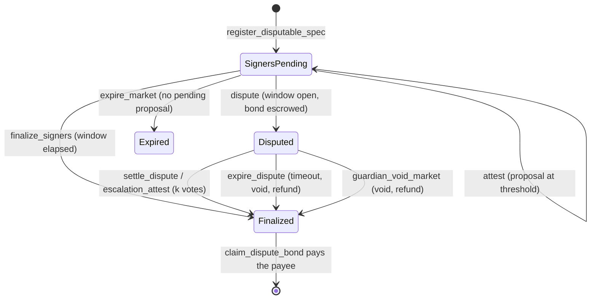

# Architecture

See the top-level diagram in [README.md](../README.md#architecture) for the
system at a glance. This doc goes one level deeper into each contract's
responsibilities and the invariants that hold across them.

## Contracts

### market-core

The hub: every binary market lives here as one entry in persistent storage,
keyed by `market_id`. Pricing is a Gnosis-style constant-product FPMM over
internal YES/NO share accounting — no external LP token, no AMM pool
contract per market. `contracts/market-core/src/math.rs` is the entire
pricing engine, pure integer arithmetic, no `Env` dependency, so it's
natively unit-testable and mirrored line-for-line in
[`model/fpmm_model.py`](../model/fpmm_model.py) and
`agents/core/fpmm.ts` for property testing and off-chain quoting.

**Solvency invariant** (holds after every state transition — see the test
suite for the ones exercised): the contract's own SEP-41 token balance for a
market equals `sets_minted + fees_accrued + lp_fees` (`fees_accrued` is the
protocol's pending share of trading fees, `lp_fees` the creator's — see the
fee split below), and `reserve_yes + Σ(user yes positions) == sets_minted`
(symmetrically for `no`).

**Fee split and recipient snapshot.** `create_market` snapshots a
`FeeTerms { recipient, protocol_share_bps }` side entry per market, so
`set_treasury` / `set_protocol_fee_share_bps` only affect markets created
after them. Each trade's fee is split once at accrual time
(`math::split_fee`, protocol shares round up so `protocol + lp == fee`
exactly): the protocol portion accumulates in `Market.fees_accrued` and is
swept to the snapshotted recipient by the permissionless `sweep_fees`
(old `FeesSwept` event kept for indexers, plus `FeesSweptTo`); the creator
portion accumulates in a `LpFees(market_id)` side entry, claimable any time
(before finality too) via `claim_lp_fees`, and also drained by
`claim_pool_remainder`. Markets created before this change have no
`FeeTerms` entry and fall back to the old behavior: recipient = whatever
`DataKey::Treasury` holds at sweep time, `protocol_share_bps = 10_000` —
fully backward compatible, no migration transaction needed. The separate
LP balance (rather than adding fees to the reserves) is deliberate: it does
not move `k` or the price and maps directly onto the per-LP fee accumulator
of the future multi-LP design ([wave-issue 02](wave-issues/02-multi-lp-liquidity.md)).

**Trade bounds and circuit breakers.** Two layers of protection beyond the
share-count slippage parameters:

- *Deadline + limit price* (#12): `buy_v2` / `sell_v2` take a
  `deadline` (ledger **timestamp**, unix seconds) checked before anything
  else, and a `limit_price_bps` bounding the **average execution price**
  (`collateral_in / shares_out` for buys, `collateral_out / shares_in` for
  sells, fee included, compared by cross-multiplication). `0` means "no
  limit" for buys; for sells it is trivially satisfied and buys no
  protection. The original `buy` / `sell` remain as thin wrappers for
  backward compatibility (same body, no bounds).
- *Per-market breakers* (#10): `BreakerConfig { max_impact_bps, band_bps }`
  is snapshotted per market from an admin default (`set_default_breaker`,
  which rejects `band_bps < max_impact_bps` because that makes one trade
  cover the whole band). `max_impact_bps` bounds a single trade's
  |post − pre| YES-price move (`>` — a trade moving exactly the cap
  passes); `band_bps` bounds |post − ledger-open price|, with the reference
  stored in short-TTL **temporary** storage keyed by ledger sequence, so it
  resets by itself every ledger. 0 disables either check; legacy markets
  have no config and are unaffected. Breaker trips revert with
  `PriceImpactTooHigh` / `PriceBandExceeded` and — because Soroban rolls
  back an invocation's events on `Err` — emit **no** event (the error codes
  and the `would_trip` / `breaker_config` / `breaker_state` views are the
  observability path; see the comment on `check_breakers`).

  *Worst-case lock cost.* The band cannot be ratcheted: the reference is
  the ledger-open price, so an attacker who pushes the price to the band
  edge only blocks further trades for the rest of that ledger (~5 s) —
  and pays the trading fee plus price impact to do it, which arbitrageurs
  can take back the next ledger. The breakers cannot lock a market across
  ledgers by construction.

**Transferability.** `transfer_position(from, to, market_id, outcome,
amount)` moves shares between any two addresses (owner auth; allowed in
every `OperatingMode` — a transfer moves no collateral — and after finality
until `redeem`), rejecting self-transfers, transfers to the contract's own
address (they could never be redeemed) and over-transfers, and emitting
`PositionTransferred` so indexers stay in sync. `transfer_lp(market_id,
new_creator)` (current-creator auth, until `lp_claimed`) moves the single
LP role — the right to `claim_pool_remainder` and `claim_lp_fees` — and
emits `LpTransferred`. Both preserve the solvency invariant by
construction; the position mapping is unchanged down to the "remove
zero entries" rule.

**Operating modes (graduated emergency control).** The old one-switch
`set_paused(bool)` trapped every trader in their positions during any
incident, because it blocked creation, `buy` *and* `sell` together while
`redeem`/`sweep_fees` kept flowing. It is now a four-state
`OperatingMode` in instance storage (`DataKey::Mode`, appended last so
existing XDR discriminants are untouched), set by the admin with
`set_mode(mode)` (emits `ModeChanged { old, new }`, readable with
`get_mode`). Every state-changing entrypoint goes through one
`assert_mode_allows(env, action)` gate:

| Action | Normal | ReduceOnly | SettleOnly | Halted |
|---|---|---|---|---|
| `create_market`, `buy` / `buy_v2` | yes | no | no | no |
| `sell` / `sell_v2` | yes | yes | no | no |
| `resolve`, `void_market` | yes | yes | yes | no |
| `redeem`, `claim_pool_remainder`, `claim_lp_fees` | yes | yes | yes | no |
| `sweep_fees` | yes | no | no | no |
| `transfer_position`, `transfer_lp` | yes | yes | yes | yes |

`ReduceOnly` is the response to a pricing bug: no *new* risk (creation and
buys stop) but holders can still exit via `sell`. `SettleOnly` is the
response to a suspected accounting or collateral bug: all trading stops, so
the bug cannot be traded against, while resolution and payouts keep working.
`sweep_fees` is the first thing to stop in both, because it moves protocol
revenue — not user funds — out of the one shared collateral balance that
backs every market. `void_market` is deliberately blocked in `Halted`: the
operator must take one explicit step to `SettleOnly` before any terminal
change. Nothing in the matrix can strand a holder — `Halted` is reversible
and `SettleOnly` always pays out (`halted_then_settle_only_allows_redeem`
locks that in, and `mode_matrix_is_enforced` locks the whole table). The
admin configuration setters (`set_resolver`, `set_treasury`,
`set_default_fee_bps`, `set_protocol_fee_share_bps`, `set_default_breaker`)
are not in the matrix and stay callable in every mode: they move no funds,
and during an incident the admin must be able to swap the resolver or the
fee recipient.

Compatibility: `set_paused(true`/`false)` still works and maps to
`Halted`/`Normal`; `Config.paused` is still populated (`mode != Normal`) so
the `Config` shape and the generated bindings are unchanged; and
`create_market`/`buy`/`sell` in `Halted` still return `Error::Paused` (2)
rather than the new `Error::ModeRestricted` (23), so clients matching on
code 2 keep working. An instance that predates `DataKey::Mode` needs no
migration — the mode is derived from the legacy boolean.

`treasury` reads `get_mode` and pre-checks it before forwarding an agent
action, so agents fail fast with treasury's own
`Error::MarketCoreRestricted` (44) instead of a nested market-core code that
would collide with treasury's numbering (market-core's `Paused` is 2, which
is treasury's `Unauthorized`). Treasury's own `Paused` flag is independent
and still checked first.

**Resolution commitment**: `resolution_hash` is fixed at `create_market`
time — see [ADR 0001](adr/0001-resolution-commitment.md) for why.

Lifecycle: `create_market` → `buy`/`sell` (while open; `buy_v2`/`sell_v2`
with bounds) → `resolve` or `void_market` (resolver-only) → `redeem` per
holder, `claim_pool_remainder` for the creator/LP, `sweep_fees`
(permissionless) to the snapshotted fee recipient. Positions and LP
ownership can change hands at any point via `transfer_position` /
`transfer_lp`.

### resolver

Independent resolution modes, all ultimately calling
`market_core.resolve(market_id, outcome)`:

- **PriceThreshold**: reads a [Reflector](https://reflector.network) SEP-40
  price feed at (or after) the market's `close_time`, compares to a
  threshold, enforces a max staleness window. Anyone may first pin that
  read with `snapshot_price` (see "Oracle history retention" below).
- **Attested**: m-of-n signer votes on a resolver-local
  `AttestedOutcome { Yes, No, Invalid }`; once `threshold` signers agree, a
  dispute window opens; anyone can finalize after it elapses, or a guardian
  (the resolver's `admin`) can `cancel_proposal` during the window.
  Finalizing `Yes`/`No` calls market-core's `resolve`; finalizing `Invalid`
  calls `void_market` (every share redeems at 0.5) and emits
  `CommitteeVoided`, so signers who agree a question is unanswerable no
  longer need the guardian to void it. market-core's `Outcome` is
  unchanged. Each outcome has its own counter and signers are deduplicated
  per `(outcome, signer)`; the first outcome to reach threshold is
  proposed and later `Yes`/`No` quorums never move it, except that an
  `Invalid` quorum replaces a pending `Yes`/`No` proposal and restarts the
  dispute window. `attest` requires `close_time` to have passed, which is
  what keeps a committee void (market-core's `void_market` has no close-time
  guard) from happening early. Proposals and finalizations emit
  `ResolutionProposedV2` / `ResolutionFinalizedV2` (carrying
  `AttestedOutcome`); the old `Outcome`-typed events are no longer
  emitted. Storage keys are versioned (`AttestationV2`, `CountV2`,
  `ProposalV2`); see ADR 0003 for the redeploy runbook and the legacy-key
  fallback.
- **Weighted keys**: a committee of raw Ed25519 public keys with weights.
  Members sign a domain-separated message off-chain and anyone submits the
  signatures to `submit_signatures` in one transaction; the weight threshold
  starts the same dispute window. `cancel_proposal` moves the market to a new
  round, invalidating earlier signatures. Message format: ADR 0001.
- **Committee with time-locked key rotation** (#35): binds resolution to a
  reusable committee registry rather than raw addresses. The admin can propose
  membership and threshold rotations with a mandatory delay (`rotation_delay >= 86_400`).
  Markets commit to `(committee_id, min_epoch, max_rotation_delta, dispute_window)`.
  Votes are checked and recounted against the committee members active at the current epoch.
- **Hybrid (price feed with attested fallback)** (#36): commits to a Reflector
  price rule and a fallback signer set. If the oracle feed fails or is unavailable
  after `close_time + fallback_delay`, anyone can call `open_fallback(market_id)` to
  allow fallback signers to propose and attest. If a valid price report arrives before
  the fallback dispute window closes, `resolve_price` immediately supersedes the proposal
  and resolves the market.

None of these modes can be configured until the revealed spec's hash matches the
market's commitment (`register_price_spec`, `register_signer_spec`,
`register_committee_spec`, or `register_hybrid_spec` — see ADR 0001).
A guardian can also `guardian_void_market` an unresolvable market directly,
subject to time windows and typed audit reasons.

#### Oracle history retention

SEP-40 oracles, Reflector included, keep a bounded history: records are
published at a fixed cadence (the feed's `resolution()`) and only a fixed
number of recent ones are retained, so `price(asset, timestamp)` returns
`None` once `timestamp` falls outside that window. Look the current values
up from Reflector's documentation or the feed contract itself; do not
assume them. A price market nobody resolves before its `close_time` record
ages out would otherwise return `PriceUnavailable` forever and could only be
voided.

`snapshot_price(market_id, caller)` closes that gap. Anyone may call it
after `close_time` while the market is unresolved; it reads the committed
feed exactly as resolution does, validates it with the same rule
(`validate_price`: not after close, no older than `max_staleness`), and
stores it as a `PriceSnapshot`. An invalid read is never stored, and the
first valid snapshot wins (`SnapshotExists`): the answer for a fixed
`(asset, close_time)` is deterministic, so this deliberately prefers
determinism over an oracle later rewriting history. Every price path
(`resolve_price`, `expire_market`, `open_fallback`, and the guardian's
`OracleUnavailable` check) uses a stored snapshot before the live feed and
then skips the oracle call. `PriceResolutionV2` adds `from_snapshot`; the
original `PriceResolution` is still emitted alongside it for one release.

Operators and agents should call `snapshot_price` within one oracle period
of `close_time` (CLI: `stellar contract invoke --id $RESOLVER -- snapshot_price
--market_id <id> --caller <address>`). A late snapshot is still accepted as
long as the oracle has the record.

#### Bonded disputes (`SignersDisputable`)

A `SignersDisputable` spec adds an optimistic challenge to Attested mode.
While a proposal's dispute window is open, anyone can `dispute` it by
escrowing `dispute_bond` of the collateral token in the resolver. That
freezes `finalize_signers`, `attest`, `cancel_proposal` and `expire_market`
(`DisputeActive`) and escalates to the authority committed in the spec: the
guardian (`settle_dispute`) or a `k`-of-`n` committee disjoint from the
signers (`escalation_attest`). Upholding the proposal resolves to it and
forfeits the bond to market-core's treasury; any other ruling resolves to the
verdict (or voids for `Invalid`) and returns the bond. If nobody rules within
`escalation_timeout` of the dispute, anyone may `expire_dispute`: the market is
voided and the bond refunded. `guardian_void_market` during a dispute also
refunds it. Bonds leave escrow only via the permissionless
`claim_dispute_bond` (pull, so a payee that cannot receive cannot block
settlement); the resolver's token balance always equals the bonds it still
holds.

**Rewards, honestly:** a winning disputer only gets their bond back. The
resolver holds no funds besides bonds, so there is nothing to pay a reward
from until signers also post bonds (signer staking is separate work). The
incentive to dispute is therefore protecting one's own position, not profit.

Liveness: `resolution_deadline` is `close_time` + 30 days. After it anyone can
call `expire_market`, which resolves the market if it still can be (valid
price feed) and otherwise voids it through market-core, so collateral is never
locked behind a missing reveal or a silent committee. See ADR 0001.

#### Attestation evidence linking (`reasoning-registry`)

Attestation votes can be bound to cryptographic traces recorded in `reasoning-registry`.
When configured via `set_evidence_config(min_policy, registry)`:
- Signers call `attest_with_evidence` citing `(trace_hash, reasoning_hash)`.
- The resolver queries `reasoning-registry` via cross-contract call to confirm that
  the trace has been published and satisfies `EvidencePolicy` (e.g. `RawBytes` vs `ReasoningBounded`).
- Each `trace_hash` can only be cited once per market (`EvidenceUsed` prevents replay).
- An audit trail of cited traces is preserved on-chain (`evidence_count`, `evidence_at`).

#### Constrained guardian powers and audit trail

To limit administrative discretion:
- **Dispute window bounds**: `cancel_proposal` can only be executed while a dispute window
  is actively open (`DisputeWindowClosed` error if closed).
- **Grace periods for voiding**: `guardian_void_market` cannot void arbitrarily; it requires
  `close_time + REVEAL_GRACE_SECS` (3 days) for unrevealed specs, `close_time + ORACLE_GRACE_SECS`
  (1 day) for failing price feeds, and `close_time + SIGNER_GRACE_SECS` (7 days) for unresponsive
  signers (`GracePeriodNotElapsed` error if called early).
- **Rate limiting**: `MAX_CANCELS_PER_MARKET = 2` prevents infinite cancellation griefing.
- **Audit trail**: Every guardian cancellation or void requires a typed `GuardianReason`
  (`StaleOracleFeed`, `CompromisedSigner`, `AmbiguousSpec`, `LivenessFailure`, `Other`),
  and emits a `GuardianAction` event with full contextual metadata.

The resolver never depends on `market-core`'s Rust crate — see
[ADR 0002](adr/0002-cross-contract-calls.md) for why, and what that trades
off.

### treasury

Holds the agents' pooled USDC and is the *only* path that spends it: an
agent calls `agent_create_market` / `agent_buy` / `agent_sell` /
`agent_buy_v2` / `agent_sell_v2` (always naming itself as the first
`agent` argument), the treasury checks the agent's role and its own
per-trade/per-market/daily caps plus the price limits, then calls
`market-core` itself as the trader/creator. This means the caps are a real on-chain limit on what the
automated agent can deploy — an agent's own key calling `market-core`
directly would just be trading its own separate funds, not bypassing a cap
on the treasury's money. The `*_v2` twins forward the same caps plus
market-core's deadline / limit-price bounds, so a revert from either layer
leaves the caps unchanged (the whole invocation is atomic).

**Agents.** The treasury keeps a registry of up to `MAX_AGENTS = 16` agents,
each with an `AgentPolicy { roles, max_trade, max_daily, active }`. Roles are
a bitmask: `ROLE_CREATE` (`agent_create_market`), `ROLE_TRADE` (`agent_buy`,
`agent_sell` and their `_v2` twins) and `ROLE_SETTLE` (`redeem`,
`claim_pool_remainder`, `close_trade`, `agent_claim_lp_fees`, the `legacy_*`
recovery calls). The constructor registers its `agent` with every role and
the global caps; `scripts/deploy-testnet.sh` then proposes a separate maker
(`CREATE | SETTLE`) and trader (`TRADE | SETTLE`), so a leaked trader key
cannot create markets and a runaway trader cannot spend the maker's budget.
An agent's `max_trade` and `max_daily` sit under the global caps; both levels
are checked on every spend, and each agent has its own sliding daily window
(`agent_daily_usage`). `TradeAuthorized.agent` names the acting agent.
Positions are still pooled: market-core only ever sees the treasury, so the
per-agent state is usage, not ownership. `remove_agent` deactivates at once
(usage history kept), but at least one active `ROLE_SETTLE` agent must always
remain so open positions can be settled. Narrowing an active agent's policy
applies at once; adding, reactivating or widening one goes through the
timelock below (`set_agent` → `execute_agent` after `config_delay`).
`get_config()` survives as a deprecated view in the old `RiskConfig` shape,
whose `agent` is the first registered agent; a stored pre-registry config is
migrated lazily into `GlobalConfig` plus one full-role agent.

**Caps.** Four limits apply to every buy and market creation:

- `max_trade`: per call.
- `max_market`: lifetime capital ever committed to one market. Never freed,
  not by sells, redemptions or `close_trade`.
- `max_daily`: a **sliding** 24h limit. Usage is kept in 25 hourly buckets
  (`UsageWindow`, instance storage); a trade at hour `h` is accepted only if
  buckets `h-24 ..= h` plus the trade stay within `max_daily`. Every real
  24h interval falls inside those 25 hours, so no trailing 24h ever exceeds
  the cap. The rounding is conservative: a trade keeps counting for 24-25h.
  (The previous fixed window reset lazily, so `max_daily` could be spent
  just before a reset and again just after it.) `daily_usage()` keeps its
  `DailyUsage` shape (`day_start` is now the start of the oldest counted
  hour) and is side-effect free; `daily_usage_detail()` returns the buckets
  and `daily_headroom()` the remaining allowance.
- `max_net_exposure`: capital *currently* deployed across all markets. The
  treasury records collateral in (buys, creations) and out (sells,
  redemptions, pool remainders, LP fee claims) per market (`NetPosition`)
  and keeps a running `net_exposure() = sum(max(0, in - out))`. Profit in
  one market floors at zero and never offsets another. A sell frees net
  headroom but not lifetime headroom; `close_trade` changes neither;
  `migrate_market` drops the market from net accounting. Enforcement uses
  only these local counters (no extra cross-contract call on the hot path)
  and never a pool price: a spot-valued cap would let anyone pump a price to
  unlock headroom or crash it to block the agent. `market_valuation(id)`
  reports `cost_basis`, a manipulation-resistant `floor_value` (complete
  sets `min(yes, no)` plus `min(reserve_yes, reserve_no)` as unclaimed LP;
  the settlement value once final), an informational `spot_value`, and
  `at_risk = max(0, cost_basis - floor_value)`. Net accounting starts when
  the contract is deployed (missing entries read as zero). The treasury's
creator-side claims are split the same way the fees are: `collect_market_fees`
sweeps the **protocol portion** to the treasury, while `agent_claim_lp_fees`
claims the LP portion for markets the treasury created.

**Price limits.** Size caps do not stop the treasury buying YES at 99% in a
pool that was at 40% a moment ago (a buggy strategy, a compromised agent key,
a sandwich). A `PricePolicy { max_buy_price_bps, min_sell_price_bps,
max_impact_bps, max_slippage_bps }` (defaults 9500 / 500 / 500 / 200) is
enforced inside every agent trade, using market-core's own `get_price` so the
rounding matches what clients see:

- buys need the outcome's spot price `<= max_buy_price_bps`, sells need it
  `>= min_sell_price_bps`; `agent_create_market` needs `initial_yes_bps`
  within `[min_sell, max_buy]`;
- `min_shares_out` is raised to the same-transaction `quote_buy` minus
  `max_slippage_bps` (never below 1), and `max_shares_in` is capped at
  `quote_sell` plus `max_slippage_bps` (rounded up);
- after the trade, `|p_after - p_before| <= max_impact_bps`.

Because the quote runs against the same pool state as the trade, the quote
floor only protects the agent's own intent; the band is what stops a
front-runner (pushing the price out of band fails the trade), and the impact
limit bounds how far any single trade moves the pool. Large trades in thin
pools are rejected by the impact limit, so strategies must split them;
`max_trade` and `max_impact_bps` interact. market-core's `SlippageExceeded`
is remapped to the treasury's own `SlippageExceeded = 27`; other market-core
errors are re-raised with market-core's codes, which overlap the treasury's
numerically. The checks add three cross-contract view calls per trade: a
1 USDC `agent_buy` against a real market-core measured ~3.5M instructions in
`price_checks_cost_estimate_recorded`.

**Timelocked configuration.** The global caps (`GlobalConfig`: collateral,
market_core, `max_trade`, `max_market`, `max_daily`, `max_net_exposure`), the
price policy and agent policies change through propose/execute with
asymmetric rules: anything that only tightens (lower caps, a narrower band,
fewer roles) applies immediately; anything that loosens (any raised cap, a
new or widened agent, a changed collateral or market-core) waits
`config_delay` (at least one day, set at construction, can only grow via
`set_config_delay`) and is announced first by `ConfigProposed` /
`AgentPolicyProposed` / `PricePolicyProposed`. A proposal that lowers one
value and raises another is a loosening as a whole; split it to apply the
tightening at once. Execution (`execute_config`, `execute_agent`,
`execute_price_policy`) is permissionless once due, so it never depends on the
admin; `cancel_*` is admin-only. A tightening applied while a loosening is
pending leaves that proposal and its timer as they are. A collateral switch
is only allowed for an empty treasury (no balance, open markets or queued
withdrawals). A market-core switch leaves positions in the old core where they
are: the old core is recorded as legacy, `legacy_redeem` /
`legacy_claim_pool_remainder` recover them, and exposure for any later core
is kept under keys namespaced by core address (the original core keeps the
old `Market(id)` / `Net(id)` keys) so restarted market ids cannot collide.
The new core still needs its own `set_treasury` for fee sweeps. This bounds
what a compromised admin can unlock *for the agents*; it is not a custody
control (see "Vault" and SECURITY.md).

**Vault.** Deposits mint internal shares against a conservative NAV and
withdrawals burn them; there is no admin `withdraw`. `nav() = idle +
Σ floor(open markets) - queue_reserved`, where an open market's floor is its
complete sets `min(yes, no)` plus `min(reserve_yes, reserve_no)` for an
unclaimed LP role, and a final market counts its exact settlement value. The
directional part of a position is valued at zero, so trading against a pool
cannot raise NAV. The open-market index walked by `nav()` is bounded at
`MAX_OPEN_MARKETS = 12` (two market-core reads each; 16 already used ~40 MB
of the 40 MiB per-transaction memory limit); a buy or creation in a 13th
market fails with `TooManyOpenMarkets`, and markets leave the index once
redeemed and claimed. Share math rounds toward the vault and uses a virtual
offset (1,000 shares / 1 stroop) plus dead shares on the first mint against
donation-based share inflation; deposits must be at least `MIN_DEPOSIT`
(10 USDC). `request_withdraw` prices the shares at once, pays what free idle
collateral allows and queues the remainder as a FIFO ticket;
`claim_withdraw(ticket)` (permissionless, pays the owner) settles the head
ticket as capital returns, and agents can never spend `queue_reserved()`.
While paused, `emergency_withdraw` pays shareholders their pro-rata part of
free idle collateral without touching market-core. See
[ADR 0005](adr/0005-treasury-vault.md).

**Migration to a successor treasury.** The treasury has no upgrade path, so
redeploying it (a bug fix, or anything the timelocked setters above do not
cover) means deploying a new contract. `set_successor(successor)`
(admin) records where value may go and emits `SuccessorSet`; then
`migrate_market(market_id)` (admin, **not** agent) moves the treasury's
YES/NO position and, if it is still the LP, its LP ownership for one market
to the successor — market by market, so the footprint stays bounded — and
emits `MarketMigrated`. The auth model:

- The agent has no path: both migration entrypoints are `require_admin`.
- The destination is fixed to the configured `Successor` — `migrate_market`
  takes no destination argument, so even a compromised agent key cannot
  redirect value. It is still an admin power over shareholders' capital:
  migrated positions leave this treasury's NAV without compensation, so a
  compromised admin could move them to a successor it controls. The
  successor is visible on-chain via `SuccessorSet` before any
  `migrate_market`, and SECURITY.md lists this as a known admin power.
- The treasury's calls to market-core's `transfer_position` / `transfer_lp`
  are *direct* calls, so market-core's `require_auth` on the treasury's own
  address is satisfied implicitly by the invoker rule — no
  `authorize_as_current_contract` entry is needed (unlike the nested token
  call in `authorize_token_pull`). This is proven by the
  `pitfall_migrate_market_needs_only_admin_auth` test, which permits only
  the admin's signature and no sub-invocations.

A migrated market's `MarketExposure` on the successor starts at zero and the
old treasury's entry is closed (`open = false`, amount preserved), so the
successor's caps apply to its own future activity — acceptable because the
cap is a per-deployment risk bound, not a market-level accounting value.
Successor-side acceptance (`accept_migration`) is deliberately not
implemented: it would record provenance only, and the events plus the
successor's own exposure records are enough for an off-chain dashboard
([wave-issue 08](wave-issues/08-treasury-exposure-dashboard.md)).

**Permissionless settlement & exposure release (#45).** Settle market capital
without depending on hot agent keys: `settle_market(caller, market_id)` is
permissionless and idempotent. It redeems the treasury's outcome-share position if
any, claims the LP remainder if the treasury created the market, marks market exposure
closed (`open = false`), and records realized proceeds under `Realized(market_id)`.
Calls to `market-core` use generated `try_` client methods so expected core errors
(`NothingToRedeem`, `AlreadyClaimed`, `NotFinal`) map cleanly to 0 or distinct treasury
errors without unhandled transaction aborts. Settlement operates even when the treasury
is paused (stopping trading, not fund recovery).

**Realized PnL & auto-pause on drawdown (#46).** Cumulative losses across markets
are bounded by an automated drawdown guard. The treasury tracks collateral cost
(buys and market seeds) and proceeds (sells, redemptions, LP remainders) per market
(`MarketPnl`). PnL is realized once a market is final and all positions/LP claims are settled
(or via permissionless `realize(market_id)` for pre-close exits). A rolling window of daily
buckets advances lazily, summing net realized PnL across `window_days`. If `window_pnl < -max_drawdown`,
the contract trips into drawdown pause (`DrawdownTripped` instance flag, emitting `DrawdownPause`).
In this mode, buys and creations are blocked, but `agent_sell` remains open (reduce-only) to avoid
trapping positions. Resuming requires admin `acknowledge_drawdown()` before unpausing. Third parties
triggering settlements cannot manipulate loss magnitude, only realization timing. Protocol fees and
external donations are strictly excluded from PnL accounting.

**Market-creation risk controls (#47).** Market seeds are decoupled from trade caps
via a dedicated `CreationPolicy` (max seed, rolling creation count limit, close horizon
bounds, allowed category bitmask). Stored in instance storage with bounded bucket arrays
(`CREATION_BUCKETS = 24`), creation limits are enforced before any cross-contract calls.
Admin policy updates are tighten-only (`set_creation_policy`), preventing a compromised key
from instantly loosening rules without a redeploy.

**Blend lending integration & JIT liquidity (#48).** Idle USDC can be supplied to a
configured Blend pool (`set_yield_venue`, `allocate_to_yield`, `recall_from_yield`) up to
`max_allocation` while preserving at least `max_daily` in liquid collateral. Spending entrypoints
(`agent_buy`, `agent_create_market`) use Just-In-Time liquidity (`ensure_liquid`): shortfalls in
liquid reserves trigger an atomic withdrawal from Blend within the same transaction. If pool
utilization prevents withdrawal, the trade reverts cleanly (`YieldWithdrawFailed`, fail-closed).
NAV views (`available_capital`) account for liquid plus supplied capital, alongside `capital_breakdown`.
See [ADR 0006](adr/0006-blend-integration.md).

The nested-authorization pitfall this design implies, and how it's handled,
is documented at length in `contracts/treasury/src/lib.rs` (see
`authorize_token_pull`) and exercised by
`pitfall_agent_buy_requires_treasury_self_authorization_for_nested_transfer`
in the same file's test module — a test that's been verified to fail
without the fix and pass with it (see the commit history / docs/STATUS.md).

### reasoning-registry

An admin allow-list of agent addresses; a registered agent calls
`publish_trace(agent, market_id, action, trace_hash, cid)` to record that a
trace exists, returning a `trace_id`. `verify_trace(trace_id, candidate_hash)`
is the check a paying subscriber (via `x402/`) or a frontend runs before
trusting fetched trace content. Traces are also indexed per market
(`market_trace_count` / `market_trace_at`) via a counter rather than an
unbounded `Vec`, so the index never has an unbounded-growth storage cost.

**Known limitation**: Soroban RPC only retains a short window of historical
events. An indexer (Soroban events → Postgres, replayable) is required for
any UI that wants to list traces/trades older than that window — this is
one of the seeded `docs/wave-issues/`.

## Off-chain pieces

- **x402/**: an Express service selling reasoning traces for ~$0.01 via
  `@x402/*`'s exact-payment Stellar scheme. Fetches the trace JSON (from
  IPFS or `reasoning-registry`'s configured store), recomputes its hash, and
  serves it only if the hash matches the on-chain record — see
  `x402/registry-trace-repository.ts`.
- **agents/**: `core/` is chain-agnostic (FPMM math including the
  price-impact quoting used to size trades under a breaker cap, trace
  building, strategy decisions with an optional impact clamp); `stellar/`
  is the only part that knows about Soroban, wrapping the generated
  bindings with a dry-run/live switch. The trader always quotes
  (`quote_buy`) immediately before submitting and derives non-zero
  `min_shares_out` / `limit_price_bps` bounds plus a deadline from it.
- **packages/bindings/**: generated TypeScript clients (`scripts/gen-bindings.sh`).

## Known limitations (see docs/STATUS.md for the full, current list)

- Testnet only; unaudited.
- No indexer yet — anything needing historical events beyond RPC's
  retention window has no on-chain-native way to query them.
- Agent-vs-agent liquidity: nothing here stops multiple independent agent
  deployments (this repo's or a fork's) from trading against the same
  market-core markets; the treasury's caps bound one agent deployment's own
  risk, not systemic market behavior.
