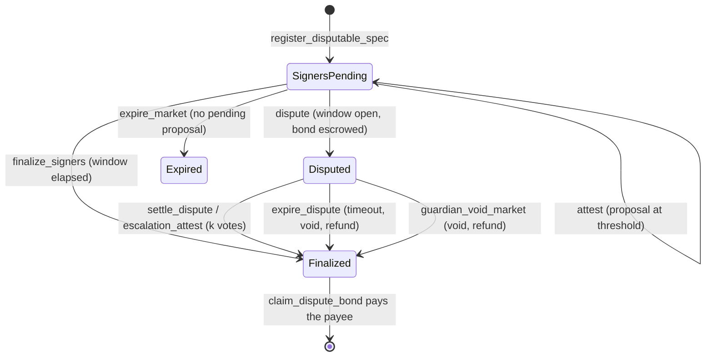

# Architecture

See the top-level diagram in [README.md](../README.md#architecture) for the
system at a glance. This doc goes one level deeper into each contract's
responsibilities and the invariants that hold across them.

## Contracts

### market-core

The hub: every market — binary, categorical, scalar — lives here as one
entry in persistent storage, keyed by `market_id`. Pricing is a Gnosis-style
constant-product FPMM over internal share accounting — no external LP token,
no AMM pool contract per market. `contracts/market-core/src/math.rs` is the
entire pricing engine, pure integer arithmetic, no `Env` dependency, so it's
natively unit-testable and mirrored line-for-line in
[`model/fpmm_model.py`](../model/fpmm_model.py) and
`agents/core/fpmm.ts` for property testing and off-chain quoting.

**Three market kinds, one id space.** A market is binary (the original
`Market`), categorical (#6, 2–8 outcomes), or scalar (#7, a range bet on a
price feed). The XDR of the original `Market` struct is never changed: each
new kind is *side storage* keyed by the same `market_id` (`DataKey::Kind`
records which kind an id is; `market_kind` exposes it), and new enum
variants are appended after the existing tags so deployed readers keep
decoding old values. Readers dispatch on `market_kind` first: `get_market`
returns `MarketNotFound` for a categorical id, whose shape lives in
`get_cat_market`. See [ADR 0006](adr/0006-market-kind-storage-split.md) for
the full argument and the alternatives rejected.

**Solvency invariant** (holds after every state transition — see the test
suite for the ones exercised): the contract's own SEP-41 token balance for a
market equals `sets_minted + fees_accrued + lp_fees` (`fees_accrued` is the
protocol's pending share of trading fees, `lp_fees` the creator's — see the
fee split below), and `reserve_yes + Σ(user yes positions) == sets_minted`
(symmetrically for `no`). The same invariant holds for categorical markets
on `CatMarket`.

**Fee split and recipient snapshot.** `create_market` snapshots a
`FeeTerms { recipient, protocol_share_bps }` side entry per market, so
`propose_treasury` / `set_protocol_fee_share_bps` only affect markets created
after them. Each trade's fee is split once at accrual time
(`math::split_fee`, protocol shares round up so `protocol + lp == fee`
exactly): the protocol portion accumulates in `Market.fees_accrued` and is
swept to the snapshotted recipient by the permissionless `sweep_fees`
(old `FeesSwept` event kept for indexers, plus `FeesSweptTo`); the creator
portion accumulates in a `LpFees(market_id)` side entry, claimable any time
(before finality too) via `claim_lp_fees`, and also drained by
`claim_pool_remainder`. Markets created before this change have no
`FeeTerms` entry and fall back to the old behavior: recipient = whatever
`DataKey::Treasury` holds at sweep time, `protocol_share_bps = 10_000` —
fully backward compatible, no migration transaction needed. The separate
LP balance (rather than adding fees to the reserves) is deliberate: it does
not move `k` or the price and maps directly onto the per-LP fee accumulator
of the future multi-LP design ([wave-issue 02](wave-issues/02-multi-lp-liquidity.md)).

**Dynamic fee schedules (#9).** A market can charge a scheduled fee instead
of a flat one. `FeeSchedule { base_bps, max_bps, ramp_secs, skew_mult_bps }`
is snapshotted at creation — from `DataKey::DefaultFeeSchedule` (set by the
admin's `set_default_fee_schedule`, which only affects markets created after
it) or from an explicit `create_market_with_fees`, whose schedule is
validated against the default's `max_bps` cap before a market id is
allocated. The effective fee is recomputed per trade by
`math::effective_fee_bps(schedule, now, close_time, r_yes, r_no)`:
`min(max_bps, base_bps + ramp + skew)`, where `ramp` rises linearly from
`base_bps` to `max_bps` over the last `ramp_secs` before `close_time` (and
stays at `max_bps` afterwards), and `skew` adds `skew_mult_bps` per 1000 bps
the pre-trade YES price sits away from 50/50. Every floor rounds in the
trader's favour; the contract layer bounds `max_bps <= MAX_FEE_BPS`,
`ramp_secs <= MAX_RAMP_SECS` (30 days) and `skew_mult_bps <= MAX_SKEW_MULT_BPS`
(1000), while the pure math only requires `base_bps <= max_bps < BPS`.
`buy` / `sell` / `quote_buy` / `quote_sell`, the `_v2` twins, and the fee
split all use the effective fee; `current_fee_bps` exposes it now, and
`quote_buy_at(market_id, outcome, collateral_in, at_timestamp)` quotes with
the fee that will apply at a *future* timestamp — the client-side latency
hedge described in [frontend-integration.md](frontend-integration.md).
`TradeV2` carries the realised `fee_bps` next to the existing `Trade` event.
Legacy markets have no schedule and keep their flat `fee_bps`; categorical
markets always charge the flat fee.

**Trade bounds and circuit breakers.** Two layers of protection beyond the
share-count slippage parameters:

- *Deadline + limit price* (#12): `buy_v2` / `sell_v2` take a
  `deadline` (ledger **timestamp**, unix seconds) checked before anything
  else, and a `limit_price_bps` bounding the **average execution price**
  (`collateral_in / shares_out` for buys, `collateral_out / shares_in` for
  sells, fee included, compared by cross-multiplication). `0` means "no
  limit" for buys; for sells it is trivially satisfied and buys no
  protection. The original `buy` / `sell` remain as thin wrappers for
  backward compatibility (same body, no bounds).
- *Per-market breakers* (#10): `BreakerConfig { max_impact_bps, band_bps }`
  is snapshotted per market from an admin default (`set_default_breaker`,
  which rejects `band_bps < max_impact_bps` because that makes one trade
  cover the whole band). `max_impact_bps` bounds a single trade's
  |post − pre| YES-price move (`>` — a trade moving exactly the cap
  passes); `band_bps` bounds |post − ledger-open price|, with the reference
  stored in short-TTL **temporary** storage keyed by ledger sequence, so it
  resets by itself every ledger. 0 disables either check; legacy markets
  have no config and are unaffected. Breaker trips revert with
  `PriceImpactTooHigh` / `PriceBandExceeded` and — because Soroban rolls
  back an invocation's events on `Err` — emit **no** event (the error codes
  and the `would_trip` / `breaker_config` / `breaker_state` views are the
  observability path; see the comment on `check_breakers`).

  *Worst-case lock cost.* The band cannot be ratcheted: the reference is
  the ledger-open price, so an attacker who pushes the price to the band
  edge only blocks further trades for the rest of that ledger (~5 s) —
  and pays the trading fee plus price impact to do it, which arbitrageurs
  can take back the next ledger. The breakers cannot lock a market across
  ledgers by construction.

**Transferability.** `transfer_position(from, to, market_id, outcome,
amount)` moves shares between any two addresses (owner auth; allowed while
`Paused` — a transfer moves no collateral — and after finality until
`redeem`), rejecting self-transfers, transfers to the contract's own
address (they could never be redeemed) and over-transfers, and emitting
`PositionTransferred` so indexers stay in sync. `transfer_lp(market_id,
new_creator)` (current-creator auth, until `lp_claimed`) moves the single
LP role — the right to `claim_pool_remainder` and `claim_lp_fees` — and
emits `LpTransferred`. Both preserve the solvency invariant by
construction; the position mapping is unchanged down to the "remove
zero entries" rule.

**Categorical markets (#6).** `create_categorical_market` opens an
n-outcome market (`2 <= n <= 8`, `MAX_MARKET_OUTCOMES`) seeded from
`probs_bps` — one probability per outcome, each within
`MIN_PROB_BPS..=MAX_PROB_BPS` and summing to exactly 10000; the creator/LP
receives the leftover shares of the likelier outcomes. The pool is the
generalized FPMM: reserves `[r_0..r_n]` with the binary invariant
`k = r_yes * r_no` replaced by `k = Π(r_i)`; a `buy_cat` of outcome `i`
moves `r_i` in and renormalizes the other reserves down so the product is
preserved (`sell_cat` is the inverse). The math uses the same iterative
floor/ceil scheme as the binary path — rounding never pays the trader and
`k` never decreases — and is property-tested in all three mirrors.
`get_prices_cat` reports implied probabilities that sum to within `n` of
10000 bps; settlement pays one unit per winning share and a void pays half
per share, exactly like the binary path. Categorical markets keep a flat
snapshotted `fee_bps` (no dynamic schedule) and no price-based breakers;
collateral, pause switch, `FeeTerms` and the `resolution_hash` commitment
are shared with `create_market`. Worst case (`n = 8`) `buy_cat` costs
444,604 instructions / 64,092 B memory / 1,640 write bytes across 5 storage
entries — under 60% of the network limits, asserted by
`cat_eight_outcomes_resource_budget`. Events: `CatTrade`,
`CatMarketResolved`.

**Scalar markets (#7).** `create_scalar_market` is a binary market
(LONG = YES, SHORT = NO) plus a `ScalarMeta { lower, upper }` display side
entry — trading, fees (dynamic schedules included), breakers and the whole
solvency story are inherited unchanged. Resolution writes
`MarketStatus::ResolvedScalar(payout_long_bps)` (an appended status variant;
0 = full SHORT, 10000 = full LONG) via `resolve_scalar`, and redemption
pays each holder `floor(yes·p / 10000) + floor(no·(10000 − p) / 10000)` —
both legs floor, so total payouts stay within `sets_minted` and a scalar
market cannot overpay. `get_scalar_meta` exposes the bounds; the meta is
display-only and never affects payouts.

**Runtime enforcement.** The invariant is no longer just a test
property. Every collateral movement in market-core goes through a
checked transfer helper that measures the actual balance delta, and a
global locked-collateral counter is updated on every inflow and outflow.
Every market shares one token balance held at the market-core address, so
the contract no longer trusts that every `token.transfer` moved exactly
the requested amount.

#### Runtime solvency accounting

**Economics.** LP worst-case loss, the rounding argument and the no-arbitrage
theorem for this exact integer math are in [fpmm-economics.md](fpmm-economics.md)
(executable checks: `model/fpmm_bounds.py`).

**Resolution commitment**: `resolution_hash` is fixed at `create_market`
time — see [ADR 0001](adr/0001-resolution-commitment.md) for why.

Lifecycle: `create_market` / `create_market_with_fees` /
`create_categorical_market` / `create_scalar_market` → `buy`/`sell`
(`buy_v2`/`sell_v2` with bounds; `buy_cat`/`sell_cat`) while open →
`resolve` / `resolve_cat` / `resolve_scalar` or `void_market`
(resolver-only) → `redeem` / `redeem_cat` per holder,
`claim_pool_remainder` / `claim_pool_remainder_cat` for the creator/LP,
`sweep_fees` (permissionless) to the snapshotted fee recipient. Positions
and LP ownership can change hands at any point via `transfer_position` /
`transfer_lp`.

The contract maintains a global counter and a per-market figure:

-  `DataKey::TotalLocked` (instance, `i128`, initialised to `0` in the
    constructor): the sum over all markets of collateral the contract
    still owes (unredeemed claims plus unswept fees).
-  `DataKey::Locked(market_id)` (persistent, `ii128`, same TT\ policy as
    `Market`): the per-market share of that obligation. It is kept in a
    separate entry so the `Market` XDR layout does not change.

Every collateral movement goes through `transfer_in` / `transfer_out`,
which measure the actual balance delta around the transfer:

Independent resolution modes, all ultimately calling
`market_core.resolve(market_id, outcome)`:

- **PriceThreshold**: reads a [Reflector](https://reflector.network) SEP-40
  price feed at (or after) the market's `close_time`, compares to a
  threshold, enforces a max staleness window. Anyone may first pin that
  read with `snapshot_price` (see "Oracle history retention" below).
- **Attested**: m-of-n signer votes on a resolver-local
  `AttestedOutcome { Yes, No, Invalid }`; once `threshold` signers agree, a
  dispute window opens; anyone can finalize after it elapses, or a guardian
  (the resolver's `admin`) can `cancel_proposal` during the window.
  Finalizing `Yes`/`No` calls market-core's `resolve`; finalizing `Invalid`
  calls `void_market` (every share redeems at 0.5) and emits
  `CommitteeVoided`, so signers who agree a question is unanswerable no
  longer need the guardian to void it. market-core's `Outcome` is
  unchanged. Each outcome has its own counter and signers are deduplicated
  per `(outcome, signer)`; the first outcome to reach threshold is
  proposed and later `Yes`/`No` quorums never move it, except that an
  `Invalid` quorum replaces a pending `Yes`/`No` proposal and restarts the
  dispute window. `attest` requires `close_time` to have passed, which is
  what keeps a committee void (market-core's `void_market` has no close-time
  guard) from happening early. Proposals and finalizations emit
  `ResolutionProposedV2` / `ResolutionFinalizedV2` (carrying
  `AttestedOutcome`); the old `Outcome`-typed events are no longer
  emitted. Storage keys are versioned (`AttestationV2`, `CountV2`,
  `ProposalV2`); see ADR 0003 for the redeploy runbook and the legacy-key
  fallback.
- **Weighted keys**: a committee of raw Ed25519 public keys with weights.
  Members sign a domain-separated message off-chain and anyone submits the
  signatures to `submit_signatures` in one transaction; the weight threshold
  starts the same dispute window. `cancel_proposal` moves the market to a new
  round, invalidating earlier signatures. Message format: ADR 0001.
- **Categorical signers**: the n-outcome counterpart of Attested.
  `register_cat_signer_spec` reveals a `CategoricalSigners` spec (signer
  set, `threshold`, `dispute_window`, and the committed `outcome_count`);
  signers call `attest_cat(market_id, outcome_index)` — the first index to
  reach `threshold` attestations becomes the proposal and opens the dispute
  window — and anyone calls `finalize_cat` after the window to resolve the
  winning index through market-core's `resolve_cat`. The guardian's
  `cancel_proposal` clears a categorical proposal too.
- **Scalar price**: `register_scalar_spec` reveals a `Scalar` spec
  (`ScalarPriceConfig`: a Reflector feed plus `lower` / `upper`). After
  `close_time`, `resolve_scalar_price` reads the feed — a non-positive
  reading is `InvalidPrice` (a broken feed, not a value at the bottom of the
  range), with the same staleness window as `resolve_price` — clamps it into
  `[lower, upper]` and settles the fractional LONG payout
  `(clamped − lower) / (upper − lower)` in bps, flooring toward the pool.
- **Committee with time-locked key rotation** (#35): binds resolution to a
  reusable committee registry rather than raw addresses. The admin can propose
  membership and threshold rotations with a mandatory delay (`rotation_delay >= 86_400`).
  Markets commit to `(committee_id, min_epoch, max_rotation_delta, dispute_window)`.
  Votes are checked and recounted against the committee members active at the current epoch.
- **Hybrid (price feed with attested fallback)** (#36): commits to a Reflector
  price rule and a fallback signer set. If the oracle feed fails or is unavailable
  after `close_time + fallback_delay`, anyone can call `open_fallback(market_id)` to
  allow fallback signers to propose and attest. If a valid price report arrives before
  the fallback dispute window closes, `resolve_price` immediately supersedes the proposal
  and resolves the market.

-  *Inbound* transfers must increase the contract balance by exactly the
    requested amount. Any mismatch reverts with `Error::CollateralMismatch`.
-  *Outbound* transfers must decrease it by exactly the amount (else
    `CollateralMismatch`), and after the decrement of `TotalLocked` the
    global guard checks `token.balance(contract) >= TotalLocked`.
    Otherwise the call reverts with `Error::Insolvent`.

The accounting rules are exactly:

The resolution lifecycle (both modes, the guardian, expiry and market-core's
status) is model-checked in TLA+; see [formal/README.md](formal/README.md) for
the properties, the findings and the conformance tests that replay the traces.

None of these modes can be configured until the revealed spec's hash matches
the market's commitment, via the `register_*_spec` entrypoint matching the
committed variant (`register_price_spec`, `register_signer_spec`,
`register_committee_spec`, `register_hybrid_spec`, `register_cat_signer_spec`,
or `register_scalar_spec` — see ADR 0001). A guardian can also
`guardian_void_market` an unresolvable market directly, subject to time
windows and typed audit reasons.

#### Oracle history retention

SEP-40 oracles, Reflector included, keep a bounded history: records are
published at a fixed cadence (the feed's `resolution()`) and only a fixed
number of recent ones are retained, so `price(asset, timestamp)` returns
`None` once `timestamp` falls outside that window. Look the current values
up from Reflector's documentation or the feed contract itself; do not
assume them. A price market nobody resolves before its `close_time` record
ages out would otherwise return `PriceUnavailable` forever and could only be
voided.

`snapshot_price(market_id, caller)` closes that gap. Anyone may call it
after `close_time` while the market is unresolved; it reads the committed
feed exactly as resolution does, validates it with the same rule
(`validate_price`: not after close, no older than `max_staleness`), and
stores it as a `PriceSnapshot`. An invalid read is never stored, and the
first valid snapshot wins (`SnapshotExists`): the answer for a fixed
`(asset, close_time)` is deterministic, so this deliberately prefers
determinism over an oracle later rewriting history. Every price path
(`resolve_price`, `expire_market`, `open_fallback`, and the guardian's
`OracleUnavailable` check) uses a stored snapshot before the live feed and
then skips the oracle call. `PriceResolutionV2` adds `from_snapshot`; the
original `PriceResolution` is still emitted alongside it for one release.

Operators and agents should call `snapshot_price` within one oracle period
of `close_time` (CLI: `stellar contract invoke --id $RESOLVER -- snapshot_price
--market_id <id> --caller <address>`). A late snapshot is still accepted as
long as the oracle has the record.

#### Bonded disputes (`SignersDisputable`)

A `SignersDisputable` spec adds an optimistic challenge to Attested mode.
While a proposal's dispute window is open, anyone can `dispute` it by
escrowing `dispute_bond` of the collateral token in the resolver. That
freezes `finalize_signers`, `attest`, `cancel_proposal` and `expire_market`
(`DisputeActive`) and escalates to the authority committed in the spec: the
guardian (`settle_dispute`) or a `k`-of-`n` committee disjoint from the
signers (`escalation_attest`). Upholding the proposal resolves to it and
forfeits the bond to market-core's treasury; any other ruling resolves to the
verdict (or voids for `Invalid`) and returns the bond. If nobody rules within
`escalation_timeout` of the dispute, anyone may `expire_dispute`: the market is
voided and the bond refunded. `guardian_void_market` during a dispute also
refunds it. Bonds leave escrow only via the permissionless
`claim_dispute_bond` (pull, so a payee that cannot receive cannot block
settlement); the resolver's token balance always equals the bonds it still
holds.



**Rewards, honestly:** a winning disputer only gets their bond back. The
resolver holds no funds besides bonds, so there is nothing to pay a reward
from until signers also post bonds (signer staking is separate work). The
incentive to dispute is therefore protecting one's own position, not profit.

Liveness: `resolution_deadline` is `close_time` + 30 days. After it anyone can
call `expire_market`, which resolves the market if it still can be (valid
price feed) and otherwise voids it through market-core, so collateral is never
locked behind a missing reveal or a silent committee. See ADR 0001.

#### Attestation evidence linking (`reasoning-registry`)

Attestation votes can be bound to cryptographic traces recorded in `reasoning-registry`.
When configured via `set_evidence_config(min_policy, registry)`:
- Signers call `attest_with_evidence` citing `(trace_hash, reasoning_hash)`.
- The resolver queries `reasoning-registry` via cross-contract call to confirm that
  the trace has been published and satisfies `EvidencePolicy` (e.g. `RawBytes` vs `ReasoningBounded`).
- Each `trace_hash` can only be cited once per market (`EvidenceUsed` prevents replay).
- An audit trail of cited traces is preserved on-chain (`evidence_count`, `evidence_at`).

#### Constrained guardian powers and audit trail

To limit administrative discretion:
- **Dispute window bounds**: `cancel_proposal` can only be executed while a dispute window
  is actively open (`DisputeWindowClosed` error if closed).
- **Grace periods for voiding**: `guardian_void_market` cannot void arbitrarily; it requires
  `close_time + REVEAL_GRACE_SECS` (3 days) for unrevealed specs, `close_time + ORACLE_GRACE_SECS`
  (1 day) for failing price feeds, and `close_time + SIGNER_GRACE_SECS` (7 days) for unresponsive
  signers (`GracePeriodNotElapsed` error if called early).
- **Rate limiting**: `MAX_CANCELS_PER_MARKET = 2` prevents infinite cancellation griefing.
- **Audit trail**: Every guardian cancellation or void requires a typed `GuardianReason`
  (`StaleOracleFeed`, `CompromisedSigner`, `AmbiguousSpec`, `LivenessFailure`, `Other`),
  and emits a `GuardianAction` event with full contextual metadata.

The resolver never depends on `market-core`'s Rust crate — see
[ADR 0002](adr/0002-cross-contract-calls.md) for why, and what that trades
off.

| Site                     | Direction           | `Locked` / `TotalLocked` delta |
|--------------------------|------------------|------------------------------|
| `create_market`          | creator -> contract | `+= seed_amount`                |
| `buy`                     | trader -> contract | `+= collateral_in` (net + fee)      |
| `sell`                    | contract -> trader | `-= collateral_out`                |
| `redeem`                  | contract -> holder | `-= payout`                        |
| `claim_pool_remainder`    | contract -> creator| `-= payout`                       |
| `sweep_fees`              | contract -> recipient| `-= amount`                        |

Notes on the rules:

Holds the agents' pooled USDC and is the *only* path that spends it: an
agent calls `agent_create_market` / `agent_buy` / `agent_sell` /
`agent_buy_v2` / `agent_sell_v2` (and `agent_buy_cat`, the categorical
forwarder; always naming itself as the first `agent` argument), the treasury
checks the agent's role, its own per-trade/per-market/daily caps plus the
price limits, then calls `market-core` itself as the trader/creator. This
means the caps are a real on-chain limit on what the
automated agent can deploy — an agent's own key calling `market-core`
directly would just be trading its own separate funds, not bypassing a cap
on the treasury's money. The `*_v2` twins forward the same caps plus
market-core's deadline / limit-price bounds, so a revert from either layer
leaves the caps unchanged (the whole invocation is atomic).

**Agents.** The treasury keeps a registry of up to `MAX_AGENTS = 16` agents,
each with an `AgentPolicy { roles, max_trade, max_daily, active }`. Roles are
a bitmask: `ROLE_CREATE` (`agent_create_market`), `ROLE_TRADE` (`agent_buy`,
`agent_sell` and their `_v2` twins) and `ROLE_SETTLE` (`redeem`,
`claim_pool_remainder`, `close_trade`, `agent_claim_lp_fees`, the `legacy_*`
recovery calls). The constructor registers its `agent` with every role and
the global caps; `scripts/deploy-testnet.sh` then proposes a separate maker
(`CREATE | SETTLE`) and trader (`TRADE | SETTLE`), so a leaked trader key
cannot create markets and a runaway trader cannot spend the maker's budget.
An agent's `max_trade` and `max_daily` sit under the global caps; both levels
are checked on every spend, and each agent has its own sliding daily window
(`agent_daily_usage`). `TradeAuthorized.agent` names the acting agent.
Positions are still pooled: market-core only ever sees the treasury, so the
per-agent state is usage, not ownership. `remove_agent` deactivates at once
(usage history kept), but at least one active `ROLE_SETTLE` agent must always
remain so open positions can be settled. Narrowing an active agent's policy
applies at once; adding, reactivating or widening one goes through the
timelock below (`set_agent` → `execute_agent` after `config_delay`).
`get_config()` survives as a deprecated view in the old `RiskConfig` shape,
whose `agent` is the first registered agent; a stored pre-registry config is
migrated lazily into `GlobalConfig` plus one full-role agent.

**Caps.** Four limits apply to every buy and market creation:

- `max_trade`: per call.
- `max_market`: lifetime capital ever committed to one market. Never freed,
  not by sells, redemptions or `close_trade`.
- `max_daily`: a **sliding** 24h limit. Usage is kept in 25 hourly buckets
  (`UsageWindow`, instance storage); a trade at hour `h` is accepted only if
  buckets `h-24 ..= h` plus the trade stay within `max_daily`. Every real
  24h interval falls inside those 25 hours, so no trailing 24h ever exceeds
  the cap. The rounding is conservative: a trade keeps counting for 24-25h.
  (The previous fixed window reset lazily, so `max_daily` could be spent
  just before a reset and again just after it.) `daily_usage()` keeps its
  `DailyUsage` shape (`day_start` is now the start of the oldest counted
  hour) and is side-effect free; `daily_usage_detail()` returns the buckets
  and `daily_headroom()` the remaining allowance.
- `max_net_exposure`: capital *currently* deployed across all markets. The
  treasury records collateral in (buys, creations) and out (sells,
  redemptions, pool remainders, LP fee claims) per market (`NetPosition`)
  and keeps a running `net_exposure() = sum(max(0, in - out))`. Profit in
  one market floors at zero and never offsets another. A sell frees net
  headroom but not lifetime headroom; `close_trade` changes neither;
  `migrate_market` drops the market from net accounting. Enforcement uses
  only these local counters (no extra cross-contract call on the hot path)
  and never a pool price: a spot-valued cap would let anyone pump a price to
  unlock headroom or crash it to block the agent. `market_valuation(id)`
  reports `cost_basis`, a manipulation-resistant `floor_value` (complete
  sets `min(yes, no)` plus `min(reserve_yes, reserve_no)` as unclaimed LP;
  the settlement value once final), an informational `spot_value`, and
  `at_risk = max(0, cost_basis - floor_value)`. Net accounting starts when
  the contract is deployed (missing entries read as zero). The treasury's
creator-side claims are split the same way the fees are: `collect_market_fees`
sweeps the **protocol portion** to the treasury, while `agent_claim_lp_fees`
claims the LP portion for markets the treasury created.

**Price limits.** Size caps do not stop the treasury buying YES at 99% in a
pool that was at 40% a moment ago (a buggy strategy, a compromised agent key,
a sandwich). A `PricePolicy { max_buy_price_bps, min_sell_price_bps,
max_impact_bps, max_slippage_bps }` (defaults 9500 / 500 / 500 / 200) is
enforced inside every agent trade, using market-core's own `get_price` so the
rounding matches what clients see:

- buys need the outcome's spot price `<= max_buy_price_bps`, sells need it
  `>= min_sell_price_bps`; `agent_create_market` needs `initial_yes_bps`
  within `[min_sell, max_buy]`;
- `min_shares_out` is raised to the same-transaction `quote_buy` minus
  `max_slippage_bps` (never below 1), and `max_shares_in` is capped at
  `quote_sell` plus `max_slippage_bps` (rounded up);
- after the trade, `|p_after - p_before| <= max_impact_bps`.

Because the quote runs against the same pool state as the trade, the quote
floor only protects the agent's own intent; the band is what stops a
front-runner (pushing the price out of band fails the trade), and the impact
limit bounds how far any single trade moves the pool. Large trades in thin
pools are rejected by the impact limit, so strategies must split them;
`max_trade` and `max_impact_bps` interact. market-core's `SlippageExceeded`
is remapped to the treasury's own `SlippageExceeded = 27`; other market-core
errors are re-raised with market-core's codes, which overlap the treasury's
numerically. The checks add three cross-contract view calls per trade: a
1 USDC `agent_buy` against a real market-core measured ~3.5M instructions in
`price_checks_cost_estimate_recorded`.

**Timelocked configuration.** The global caps (`GlobalConfig`: collateral,
market_core, `max_trade`, `max_market`, `max_daily`, `max_net_exposure`), the
price policy and agent policies change through propose/execute with
asymmetric rules: anything that only tightens (lower caps, a narrower band,
fewer roles) applies immediately; anything that loosens (any raised cap, a
new or widened agent, a changed collateral or market-core) waits
`config_delay` (at least one day, set at construction, can only grow via
`set_config_delay`) and is announced first by `ConfigProposed` /
`AgentPolicyProposed` / `PricePolicyProposed`. A proposal that lowers one
value and raises another is a loosening as a whole; split it to apply the
tightening at once. Execution (`execute_config`, `execute_agent`,
`execute_price_policy`) is permissionless once due, so it never depends on the
admin; `cancel_*` is admin-only. A tightening applied while a loosening is
pending leaves that proposal and its timer as they are. A collateral switch
is only allowed for an empty treasury (no balance, open markets or queued
withdrawals). A market-core switch leaves positions in the old core where they
are: the old core is recorded as legacy, `legacy_redeem` /
`legacy_claim_pool_remainder` recover them, and exposure for any later core
is kept under keys namespaced by core address (the original core keeps the
old `Market(id)` / `Net(id)` keys) so restarted market ids cannot collide.
The new core still needs its own `propose_treasury` handshake for fee sweeps.
This bounds
what a compromised admin can unlock *for the agents*; it is not a custody
control (see "Vault" and SECURITY.md).

**Vault.** Deposits mint internal shares against a conservative NAV and
withdrawals burn them; there is no admin `withdraw`. `nav() = idle +
Σ floor(open markets) - queue_reserved`, where an open market's floor is its
complete sets `min(yes, no)` plus `min(reserve_yes, reserve_no)` for an
unclaimed LP role, and a final market counts its exact settlement value. The
directional part of a position is valued at zero, so trading against a pool
cannot raise NAV. The open-market index walked by `nav()` is bounded at
`MAX_OPEN_MARKETS = 12` (two market-core reads each; 16 already used ~40 MB
of the 40 MiB per-transaction memory limit); a buy or creation in a 13th
market fails with `TooManyOpenMarkets`, and markets leave the index once
redeemed and claimed. Share math rounds toward the vault and uses a virtual
offset (1,000 shares / 1 stroop) plus dead shares on the first mint against
donation-based share inflation; deposits must be at least `MIN_DEPOSIT`
(10 USDC). `request_withdraw` prices the shares at once, pays what free idle
collateral allows and queues the remainder as a FIFO ticket;
`claim_withdraw(ticket)` (permissionless, pays the owner) settles the head
ticket as capital returns, and agents can never spend `queue_reserved()`.
While paused, `emergency_withdraw` pays shareholders their pro-rata part of
free idle collateral without touching market-core. See
[ADR 0005](adr/0005-treasury-vault.md).

**Migration to a successor treasury.** The treasury has no upgrade path, so
redeploying it (a bug fix, or anything the timelocked setters above do not
cover) means deploying a new contract. `set_successor(successor)`
(admin) records where value may go and emits `SuccessorSet`; then
`migrate_market(market_id)` (admin, **not** agent) moves the treasury's
YES/NO position and, if it is still the LP, its LP ownership for one market
to the successor — market by market, so the footprint stays bounded — and
emits `MarketMigrated`. The auth model:

- The agent has no path: both migration entrypoints are `require_admin`.
- The destination is fixed to the configured `Successor` — `migrate_market`
  takes no destination argument, so even a compromised agent key cannot
  redirect value. It is still an admin power over shareholders' capital:
  migrated positions leave this treasury's NAV without compensation, so a
  compromised admin could move them to a successor it controls. The
  successor is visible on-chain via `SuccessorSet` before any
  `migrate_market`, and SECURITY.md lists this as a known admin power.
- The treasury's calls to market-core's `transfer_position` / `transfer_lp`
  are *direct* calls, so market-core's `require_auth` on the treasury's own
  address is satisfied implicitly by the invoker rule — no
  `authorize_as_current_contract` entry is needed (unlike the nested token
  call in `authorize_token_pull`). This is proven by the
  `pitfall_migrate_market_needs_only_admin_auth` test, which permits only
  the admin's signature and no sub-invocations.

A migrated market's `MarketExposure` on the successor starts at zero and the
old treasury's entry is closed (`open = false`, amount preserved), so the
successor's caps apply to its own future activity — acceptable because the
cap is a per-deployment risk bound, not a market-level accounting value.
Successor-side acceptance (`accept_migration`) is deliberately not
implemented: it would record provenance only, and the events plus the
successor's own exposure records are enough for an off-chain dashboard
([wave-issue 08](wave-issues/08-treasury-exposure-dashboard.md)).

- `buy` locks `collateral_in = net + fee`, because `net` mints sets and
  `fee` accrues to the protocol/LP shares. The fee remains inside
  `locked` until `sweep_fees` / `claim_lp_fees` / `claim_pool_remainder`
  subtract it — it is never double-counted.
- `sell` burns gross sets and pays out `collateral_out`; the fee
  `gross - out` stays in the market's fee accrual, and the locked delta is
  only the cash actually leaving.
- `claim_pool_remainder` zeroes the reserves and subtracts the payout
  from `locked`. After this claim, `sets_minted`+`$fees_accrued` is no
  longer the correct figure for what the market still owes; the
  solvency report uses `locked` alone in that state.
- `sweep_fees` subtracts the swept amount from `locked`.
- Any negative result returns `Error::Overflow` (with a `debug_assert`
  in debug builds).

**Permissionless settlement & exposure release (#45).** Settle market capital
without depending on hot agent keys: `settle_market(caller, market_id)` is
permissionless and idempotent. It redeems the treasury's outcome-share position if
any, claims the LP remainder if the treasury created the market, marks market exposure
closed (`open = false`), and records realized proceeds under `Realized(market_id)`.
Calls to `market-core` use generated `try_` client methods so expected core errors
(`NothingToRedeem`, `AlreadyClaimed`, `NotFinal`) map cleanly to 0 or distinct treasury
errors without unhandled transaction aborts. Settlement operates even when the treasury
is paused (stopping trading, not fund recovery).

**Realized PnL & auto-pause on drawdown (#46).** Cumulative losses across markets
are bounded by an automated drawdown guard. The treasury tracks collateral cost
(buys and market seeds) and proceeds (sells, redemptions, LP remainders) per market
(`MarketPnl`). PnL is realized once a market is final and all positions/LP claims are settled
(or via permissionless `realize(market_id)` for pre-close exits). A rolling window of daily
buckets advances lazily, summing net realized PnL across `window_days`. If `window_pnl < -max_drawdown`,
the contract trips into drawdown pause (`DrawdownTripped` instance flag, emitting `DrawdownPause`).
In this mode, buys and creations are blocked, but `agent_sell` remains open (reduce-only) to avoid
trapping positions. Resuming requires admin `acknowledge_drawdown()` before unpausing. Third parties
triggering settlements cannot manipulate loss magnitude, only realization timing. Protocol fees and
external donations are strictly excluded from PnL accounting.

**Market-creation risk controls (#47).** Market seeds are decoupled from trade caps
via a dedicated `CreationPolicy` (max seed, rolling creation count limit, close horizon
bounds, allowed category bitmask). Stored in instance storage with bounded bucket arrays
(`CREATION_BUCKETS = 24`), creation limits are enforced before any cross-contract calls.
Admin policy updates are tighten-only (`set_creation_policy`), preventing a compromised key
from instantly loosening rules without a redeploy.

**Blend lending integration & JIT liquidity (#48).** Idle USDC can be supplied to a
configured Blend pool (`set_yield_venue`, `allocate_to_yield`, `recall_from_yield`) up to
`max_allocation` while preserving at least `max_daily` in liquid collateral. Spending entrypoints
(`agent_buy`, `agent_create_market`) use Just-In-Time liquidity (`ensure_liquid`): shortfalls in
liquid reserves trigger an atomic withdrawal from Blend within the same transaction. If pool
utilization prevents withdrawal, the trade reverts cleanly (`YieldWithdrawFailed`, fail-closed).
NAV views (`available_capital`) account for liquid plus supplied capital, alongside `capital_breakdown`.
See [ADR 0006](adr/0006-blend-integration.md).

The nested-authorization pitfall this design implies, and how it's handled,
is documented at length in `contracts/treasury/src/lib.rs` (see
`authorize_token_pull`) and exercised by
`pitfall_agent_buy_requires_treasury_self_authorization_for_nested_transfer`
in the same file's test module — a test that's been verified to fail
without the fix and pass with it (see the commit history / docs/STATUS.md).

The global guard is the only check that can be made against the shared
ledger balance: a per-market figure cannot be verified on-chain because
the balance is shared across markets. Donations (anyone sending tokens
directly to the contract) make `balance > TotalLocked`, which is
normal and must not revert.

#### Treasury cap guarantees

What the caps actually promise, as checked by
`contracts/integration-tests/tests/treasury_caps_exhaustive` (below), so that
"daily cap" is not over-read. Auth is mocked in that search; wrong-caller
behaviour is covered by each contract's own tests.

**Guaranteed** (every reachable state of the searched alphabet, I1-I9):

| | Guarantee |
|---|---|
| I1 per call | A successful `agent_buy` spends at most `max_trade`. A successful `agent_create_market` seeds at most `max_seed` (the creation policy, which may exceed `max_trade`; it is also at most `max_market`). |
| I2 per market | Cumulative agent spend into one market, seed included, is at most `max_market`, for the market's whole life: it is never freed by sells or `close_trade`. `MarketExposure.amount` equals the observed sum of spends. |
| I3 daily | The treasury's reported window (`daily_usage`) never exceeds `max_daily` and equals the spends observed since its reported start. |
| I4 sliding 24h | In **any** interval `[t, t + 86_400)` the agent spends at most `max_daily`. The window is hourly buckets summed over the trade's hour and the 24 hours before it: effectively 24-25h, conservative and never permissive. |
| I5 pause | While the admin has paused, `agent_buy`, `agent_create_market` and `agent_sell` all fail with `Paused`. `close_trade`, `redeem` and `claim_pool_remainder` stay callable: they spend nothing and return capital. (An automatic drawdown pause differs: reduce-only sells stay allowed; not part of this search.) |
| I6 accounting | Treasury token balance = initial - Σ spends + Σ returns (sells, redeems, claims), from the operations' own parameters. |
| I7 sell neutrality | `agent_sell` changes neither the daily window nor any `MarketExposure`. |
| I8 | Net exposure stays within `max_net_exposure`. |
| I9 completeness | An operation within every observable cap succeeds, so a cap is not silently stricter than documented (this is what catches an off-by-one such as `>=` for `>` on `max_market`). |
| Atomicity | A failed call changes no observed quantity (balances, window, exposures, net exposure). |

**Not guaranteed:**

- *Admin actions are not agent spending.* `withdraw`, `emergency_withdraw`,
  config changes after their timelock, and the market-core admin swapping the
  resolver or treasury role all bypass these caps by design.
- *`max_daily` is not a calendar-day cap.* It is a trailing 24-25h cap, so the
  agent can be refused a spend that is a few minutes over 24h after a previous
  one. It is also not a cap on losses by itself: an agent may spend `max_daily`
  every 25 hours, and per market until `max_market`.
- *History: this used to be 2x.* The original fixed window reset to `now` at
  the first call after 24h, so an agent could spend `max_daily` just before a
  reset and `max_daily` just after (up to `2 * max_daily` in a short span). The
  sliding window fixed that; the explorer was written expecting to *report*
  that violation (I4) and now finds none. Mutating `BUCKETS` from 25 to 24
  brings I4 back with a depth-5 counterexample (5U spent in one 24h span
  against `max_daily = 4U`), pinned by the treasury unit test
  `explorer_i4_sequence_stays_within_max_daily`.
- *Prices and breakers are out of scope.* The search lifts the price policy;
  slippage, price band and impact are tested separately.
- *The search is bounded.* "Holds up to depth N over this alphabet", not a
  proof for all sequences, caps or market counts.

##### The search

```bash
cargo test -p integration-tests treasury_caps_exhaustive -- --nocapture          # depth 6
TREASURY_SEARCH_DEPTH=8 cargo test -p integration-tests treasury_caps_exhaustive -- --nocapture
TREASURY_SEARCH_ALPHABET=full ...                  # the complete alphabet
TREASURY_SEARCH_MARKET_CORE=wasm ...               # market-core in the Soroban VM
```

Operations: `agent_buy` and `agent_sell` on each market, `agent_create_market`,
`close_trade`, clock advances `{1, 43_200, 86_399, 86_400}` s, and admin
`Pause`/`Unpause`, over two pre-existing third-party markets (and up to two
treasury-created ones). Caps are in units `U` = 100 USDC (`MIN_SEED`): four
configurations (`max_trade/max_market/max_daily` = 2U/3U/4U, all equal to 2U,
a `max_seed` of 3U above `max_trade`, and markets that close after a day so
buys hit `MarketClosed`). Failures are never classified by error code alone
(a market-core error is re-raised under its own code, and e.g. `MarketClosed`
is 9, the same as the treasury's `InsufficientBalance`).

- *Order:* breadth-first, so the first violation is a shortest one, printed as
  a replayable test body (`f.buy(0, 2 * U); f.advance(86_399); ...`).
- *Memoization:* a canonical key of the behaviourally relevant state: pause
  flag, `now % 3600`, the window's buckets newest-first, the spends of the last
  25h by exact age (the history I4 needs), and per market the exposure, open
  flag, treasury share count (bucketed) and closed status. Absolute time is
  never in the key, and market reserves deliberately are not (they only decide
  whether a trade clears market-core, which the share bucket and closed status
  cover); including them makes almost every trade ordering a distinct state.
- *Symmetry:* the two pre-existing markets are interchangeable, so market
  summaries are sorted in the key, and an operation on a market whose
  summary equals a lower-indexed one is skipped.
- *Snapshots vs replay:* each child state is built either by re-running the
  path on a fresh world or by restoring an `Env` snapshot of the parent.
  Measured (`cargo test -p integration-tests -- --ignored branching_benchmark
  --nocapture`, depth 3): replay 7.4 ms/operation, snapshot 3.7 ms/operation,
  and the gap grows with depth because replay is O(depth). Both produce
  identical state counts; snapshot restore is used. Two non-obvious details:
  `Env::from_snapshot` always writes a test-snapshot JSON file when the `Env`
  is dropped on a *named* thread (every test thread is), which cost 7 minutes
  for 4,000 operations, so the search runs on unnamed threads (the SDK skips
  the write then); and native contracts are not part of a snapshot, so they are
  re-registered with their constructor turned into a no-op.
- *Market-core:* the deep search registers `market-core` natively for speed;
  `market_core_wasm_matches_native` runs depth 4 on the vendored wasm and
  asserts exactly the same states, operations and growth. The treasury is also
  native (the wasm artifact does not exist at `cargo test` time), i.e. the real
  contract code, not a mock.
- *Alphabet:* the default `lean` alphabet drops 1s clock ticks, `close_trade`,
  seeds that always fail the seed cap, sells with no shares and a second
  treasury-created market; `full` is the complete one and is for deeper runs
  (below).
- *Results* (depth 6, lean, native market-core, 8 threads): 9,940 abstract
  states, 115,208 operations, 103 s; no violation. `full`, depth 5: 7,653
  states, 130,218 operations, 98 s (measured). The work grows about 3.5-5x per
  depth, so `full` at depth 6 and `lean` at depth 8 are estimated at roughly
  8 and 20 minutes on 8 cores (not measured). The nightly workflow
  (`.github/workflows/treasury-search-nightly.yml`) runs a deeper search and
  keeps its output as an artifact; hosted runners have fewer cores, so expect
  a few times longer there.
- *Teeth* (recorded in the PR): `new_market > max_market` mutated to `>=` is
  reported at depth 2 as an I9 failure (`1U + 2U = 3U` is exactly the cap and
  must be allowed); deleting `assert_not_paused` from `agent_buy` is reported
  at depth 2 as an I5 violation (`f.pause(true); f.buy(0, 1 * U);`); the
  24-bucket window above is reported as I4 at depth 5.

### reasoning-registry

**Views.** `solvency_report(market_id)` returns a `SolvencyReport`
with the market's locked collateral, fees accrued, sets minted, and
 outstanding-claims upper bound (`sets_minted + fees_accrued` while
open or unclaimed, derived from `locked` alone after the LP claim),
plus `lp_claimed`. `global_solvency()` returns `(token.balance(contract),
TotalLocked)`. The per-market figure is an audit aid, not an enforced
check; the global guard is the enforced one.

**Misbehaving collateral.** A fee-on-transfer or rebasing SEP-41 token, a
Classic asset whose issuer has `AUTH_CLAWBACK_ENABLED` and claws back
from the contract, or a buggy custom collateral each make the contract hold
less than it owes. The balance-delta checks reject fee-on-transfer
collateral at the first inflow (`CollateralMismatch`). If the issuer claws
back between transactions, the next outbound transfer trips `Insolvent`.
That freezes payouts globally — intentional fail-safe behaviour, so the
shortfall is visible instead of silently draining other markets.

The contract has no upgrade path today (see `scripts/deploy-testnet.sh`), so
this is a new-deployment-only change: a redeployed market-core starts from
`TotalLocked = 0`. There is deliberately no admin setter to backfill the
counter for pre-existing markets, because that would be an obvious
privileged backdoor.

**Fee split and recipient snapshot.** `create_market` snapshots a
`FeeTerms { recipient, protocol_share_bps }` side entry per market, so
`set_treasury` / `set_protocol_fee_share_bps` only affect markets created
after them. Each trade's fee is split once at accrual time
(`math::split_fee`, protocol shares round up so `protocol + lp == fee`
exactly): the protocol portion accumulates in `Market.fees_accrued` and is
swept to the snapshotted recipient by the permissionless `sweep_fees`(old `FeesSwept` event kept for indexers, plus `FeesSweptTo`); the creator
portion accumulates in a `LpFees(market_id)` side entry, claimable any time
(before finality too) via `claim_lp_fees`, and also drained by
`claim_pool_remainder`. Markets created before this change have no
`FeeTerms` entry and fall back to the old behavior: recipient = whatever
`DataKey::Treasury` Holds at sweep time, `protocol_share_bps = 10_000` —
fully backward compatible, no migration transaction needed. The separate
LP balance (rather than adding fees to the reserves) is deliberate: it does
not move `k` or the price and maps directly onto the per-LP fee accumulator
of the future multi-LP design ([wave-issue 02](wave-issues/02-multi-lp-liquidity.md)).

#### Agent Lifecycle and Trace Annotations (#56)

The reasoning registry models an explicit lifecycle for agents and traces:
- **Agent lifecycle**: Agents hold `AgentRecord { status: AgentStatus, registered_at: u64 }`.
  - `Active`: Registered agent permitted to publish traces.
  - `Retired(at)`: Agent gracefully retired by admin (`retire_agent`) or the agent itself (`retire_self`). Retired agents cannot publish new traces, but their existing traces remain valid. Admin may call `reactivate_agent` to return a retired agent to `Active`.
  - `Revoked(effective_from, reason)`: Agent revoked by admin (`revoke_agent`) due to compromise or malfeasance. Revocations cannot be reversed or reactivated, preventing history laundering.
- **Trace flagging**: The admin can annotate suspect traces via `flag_trace(trace_id, reason)` and `unflag_trace(trace_id, reason)`. Flags are annotations appended to a bounded history (max 16 entries) and never modify or erase the underlying trace data.
- **Trace verdict**: `trace_verdict(trace_id, received_hash)` evaluates validity in strict precedence:
  1. Not found -> `Err(TraceNotFound)`
  2. Hash differs -> `TraceVerdict::HashMismatch`
  3. Active flag -> `TraceVerdict::Flagged(reason)`
  4. Agent revoked with `trace.published_at >= effective_from` -> `TraceVerdict::AgentRevokedAfter(effective_from)`
  5. Otherwise -> `TraceVerdict::Valid`
- **Semantic tightening of `verify_trace`**: `verify_trace` returns `true` only if `trace_verdict` evaluates to `TraceVerdict::Valid`. Clients wishing to perform bare hash comparison without status checks can query `get_trace`.

#### Trace Action Validation and Market Reference Integrity (#55)

Traces reference concrete market actions validated against `market-core`:
- **Canonical Action Vocabulary**: `TraceAction` replaces free-form strings:
  | Action | Target Market | Description |
  | :--- | :--- | :--- |
  | `CreateMarket` | Issued `market_id` | Creation of a new market on-chain |
  | `ProposeMarket` | `NO_MARKET` (`u64::MAX`) | Off-chain market proposal prior to creation |
  | `Buy` | Issued `market_id` | Purchase of YES or NO shares |
  | `Sell` | Issued `market_id` | Sale of YES or NO shares |
  | `Skip` | Issued `market_id` | Evaluated market but took no trade action |
  | `Redeem` | Issued `market_id` | Redemption of winning or voided shares |
  | `ClaimRemainder` | Issued `market_id` | LP reclamation of unredeemed collateral pool |
  | `Resolve` | Issued `market_id` | Resolver or oracle resolution attestation |
  | `Other(Symbol)` | Issued `market_id` or `NO_MARKET` | Forward-compatible custom action; cannot shadow canonical action names |
- **Market Reference Validation**:
  - `market_core.market_count()` is checked via cross-contract read.
  - A referenced `market_id` must satisfy `market_id < market_count()`.
  - `ProposeMarket` requires `NO_MARKET` (`u64::MAX`), returning `Error::ProposalMustUseNoMarket` if given an actual `market_id`.
  - Canonical actions (`Buy`, `Sell`, etc.) reject `NO_MARKET` with `Error::MarketRequired`.
  - View function calls to `market_count()` remain functional even when `market-core` is paused.

#### Merkle-Batched Trace Anchoring (#54)

To slash per-decision publishing costs for high-frequency trading or extensive skip auditing:
- **Off-chain Batching**: Agents collect up to 4,096 trace hashes off-chain, compute a Merkle tree, and anchor the 32-byte root and manifest CID on-chain via `publish_trace_batch(agent, root, leaf_count, manifest_cid)`.
- **Cryptographic Specifications**:
  - **Second-Preimage Resistance**: RFC 6962 domain separation prefixes: leaves hash with `0x00 || trace_hash`, inner nodes hash with `0x01 || left || right`.
  - **Odd Node Promotion**: An odd child at any tree layer is promoted unchanged to the next level without duplicating or hashing with itself. When verifying an odd node, no proof element is consumed for that layer.
  - **Bounded Proof Length**: With `MAX_LEAVES = 4096`, proof length is strictly bounded to `MAX_PROOF_LEN = 12`. Any proof exceeding 12 elements is rejected with `Error::InvalidProof`.
- **Verification**: `verify_trace_inclusion(batch_id, trace_hash, index, proof)` and `compute_merkle_root(leaf_count, trace_hash, index, proof)` enable on-chain and off-chain (x402 verifier, agents) verification against canonical golden test vectors (`docs/vectors/merkle-v1.json`).

#### Ed25519-Signed Trace Attestations (#53)

To enable independent verification of trace authenticity without trusting the registry admin:
- **Dedicated Agent Signing Keys**: Agents bind dedicated Ed25519 public keys (`BytesN<32>`) to their on-chain identity via `add_signing_key(agent, public_key, proof_sig)`.
  - **Proof of Possession**: `proof_sig` proves ownership of the secret key by signing `"oracledesk-agent-key-v1" || network_id || registry_id || agent_xdr || public_key`.
  - **Key Binding & Lifecycle**: Keys are uniquely bound to agents (at most 4 active keys per agent) with full rotation history (`SigningKeyRecord { public_key, added_at, retired_at }`) tracked via `retire_signing_key`.
- **Domain-Separated Trace Attestation**: `publish_trace_signed(agent, market_id, action, trace_hash, ipfs_cid, signing_key, signature)`:
  - Message format: `"oracledesk-trace-v1" || network_id || registry_id || agent_xdr || market_id_be || action_tag || trace_hash`.
  - On-chain verification via `env.crypto().ed25519_verify`.
  - The attestation signature is stored under `TraceSignature(trace_id)` and queriable via `get_trace_signature` and `verify_trace_signature`.
- **Zero-Trust Offline Verification**: Any consumer holding the trace JSON and public key (e.g., an x402 subscriber or frontend auditor) can verify authenticity offline without RPC access or reliance on contract admin honesty.

**Known limitation**: Soroban RPC only retains a short window of historical
events. An indexer (Soroban events → Postgres, replayable) is required for
any UI that wants to list traces/trades older than that window — this is
one of the seeded `docs/wave-issues/`.

### router

A stateless address book (`RouterConfig { market_core, resolver,
reasoning_registry }`) plus atomic multi-step entrypoints, so a client cannot
half-apply a flow or point it at a hostile resolver (ADR 0009):
`create_and_reveal_signers` / `create_and_reveal_price` (create the market and
reveal its rule in one transaction; the commitment is computed locally from
the spec), `reveal_spec` (the deferred commit-now/reveal-later path), and
`buy_and_publish_trace` (buy through market-core and publish the reasoning
trace together, so a trade cannot drop its trace). It holds no funds and has
no admin.

### Governance: wiring, admin transfer, timelock

- **Authenticated wiring (ADR 0006).** `market-core` no longer lets the admin
  set the resolver/treasury directly. It `propose_resolver` /
  `propose_treasury`; the target must then prove, by calling back
  `market_core()`, that it is configured for this market-core before it takes
  the role. Every change emits `ResolverProposed`/`ResolverChanged` (and the
  treasury equivalents). Deploys are deterministic (`--salt`), so the real
  addresses are known before `market-core`'s constructor runs and there is no
  placeholder window.
- **Two-step admin transfer (ADR 0007).** All four core contracts (and the
  timelock) expose `propose_admin`/`accept_admin`/`cancel_admin_transfer` with
  a seven-day expiry. The new admin must accept, so a proposal to an address
  the operator does not control never lands; `new_admin` may be a classic
  multisig account, a smart-account multisig, or the timelock.
- **Timelock (ADR 0008).** `contracts/timelock` separates the proposer,
  canceller, executor and emergency roles and imposes a delay
  (`MIN_DELAY = 1 day`) between `schedule` and `execute`, with a seven-day
  execution grace and a `cancel` veto. `emergency` bypasses the delay for
  `set_paused(true)` / `cancel_proposal` only. Pointing the core contracts'
  admin at the timelock (deploy with `USE_TIMELOCK=1`, or migrate with
  `scripts/wire-timelock.sh`) removes any single key's ability to change a
  live market instantly.

## Off-chain pieces

- **x402/**: an Express service selling reasoning traces for ~$0.01 via
  `@x402/*`'s exact-payment Stellar scheme. Fetches the trace JSON (from
  IPFS or `reasoning-registry`'s configured store), recomputes its hash, and
  serves it only if the hash matches the on-chain record — see
  `x402/registry-trace-repository.ts`.
- **agents/**: `core/` is chain-agnostic (FPMM math including the
  price-impact quoting used to size trades under a breaker cap, trace
  building, strategy decisions with an optional impact clamp); `stellar/`
  is the only part that knows about Soroban, wrapping the generated
  bindings with a dry-run/live switch. The trader always quotes
  (`quote_buy`) immediately before submitting and derives non-zero
  `min_shares_out` / `limit_price_bps` bounds plus a deadline from it. In
  live mode it reads `get_market` and `current_fee_bps` first, and sizes the
  trade under the market's price-impact breaker when one is configured.
- **packages/bindings/**: generated TypeScript clients (`scripts/gen-bindings.sh`).

**Trade bounds and circuit breakers.** Two layers of protection beyond the
share-count slippage parameters:

- *Deadline + limit price* (#12): `buy_v2` / `sell_v2` take a
  `deadline` (ledger **timestamp**, unix seconds) checked before anything
  else, and a `limit_price_bps` bounding the **average execution price**
  (`collateral_in / shares_out` for buys, `collateral_out / shares_in` for
  sells, fee included, compared by cross-multiplication). `0` means "no
  limit" for buys; for sells it is trivially satisfied and buys no
  protection. The original `buy` / `sell` remain as thin wrappers for
  backward compatibility (same body, no bounds).
- *Per-market breakers* (#10): `BreakerConfig { max_impact_bps, band_bps }`
  is snapshotted per market from an admin default (`set_default_breaker`,
  which rejects `band_bps < max_impact_bps` because that makes one trade
  cover the whole band). `max_impact_bps` bounds a single trade's
  |post − pre| YES-price move (`>` — a trade moving exactly the cap
  passes); `band_bps` bounds |post − ledger-open price|, with the reference
  stored in short-TTL **temporary** storage keyed by ledger sequence, so it
  resets by itself every ledger. 0 disables either check; legacy markets
  have no config and are unaffected. Breaker trips revert with
  `PriceImpactTooHigh` / `PriceBandExceeded` and — because Soroban rolls
  back an invocation's events on `Err` — emit **no** event (the error codes
  and the `would_trip`` / `breaker_config` / `breaker_state` views are the
  observability path; see the comment on `check_breakers`).

  *Worst-case lock cost.* The band cannot be ratcheted: the reference is
  the ledger-open price, so an attacker who pushes the price to the band
  edge only blocks further trades for the rest of that ledger (~5 s) —
  and pays the trading fee plus price impact to do it, which are both
  retained by the pool.

**Resolution and payouts.** `resolve(market_id, outcome)` sets the
final outcome once. `redeem` pays `payout` for a winning position and
burns it; `lp_claimed` gates `claim_pool_remainder`, which pays the
creator the residual value of the reserves and zeroes them. Both payouts
 are subject to the checked transfer and global solvency guard.

### IPFS trace storage

In live mode the agents store traces with `IpfsTraceStore`
(`agents/core/ipfs-store.ts`; selected by `TRACE_STORE`, see
`agents/core/trace-store-factory.ts`). The CID that goes on-chain in
`publish_trace(..., ipfs_cid)` is permanent, because `Trace` entries have no
update path. So the agent computes the CID itself and does not trust any
pinning provider to name the content:

- **Raw CIDv1.** The CID is a CIDv1 with the `raw` codec (`0x55`) and a
  sha2-256 multihash over the exact UTF-8 bytes `buildTrace` hashed
  (base32 lowercase, `bafkrei…`, 59 characters). Its multihash digest is
  therefore *equal to* `trace_hash`. A default `ipfs add` (dag-pb/UnixFS,
  chunked) would hash a protobuf wrapper instead and break that property,
  so kubo is called with `cid-version=1&raw-leaves=true&hash=sha2-256` and a
  1 MiB chunker, and traces are limited to one 1 MiB block.
- **Providers are verified, not trusted.** Any provider that reports a CID
  different from the local one (compared by value with `CID.equals`, not by
  string) fails the whole `put`. Pins go to a kubo RPC node and optionally an
  IPFS Pinning Service API (`POST /pins`, polled until `pinned`). Each
  provider is retried with jittered backoff, and at least `IPFS_MIN_PINS`
  must *confirm* the pin. Queued pins count only with `IPFS_ACCEPT_QUEUED=1`.
- **Retrievability is checked.** Before `put` resolves, the agent GETs
  `${IPFS_GATEWAY_URL}/<cid>` (the gateway x402 also reads), following
  redirects, with a byte cap and a timeout, and re-checks `sha256(body)`.
  The trade or market creation is only submitted after this succeeds. If
  pinning fails, the action is skipped and logged.
- The market-maker also pins a small metadata document (question, category,
  close time, trace hash and CID) and sets the market's `meta_uri` to
  `ipfs://<cid>`. `local://` URIs remain only in dry-run, or in live mode with
  `ALLOW_LOCAL_TRACE_STORE=1`.

**Verifying without fetching.** A buyer holding `(trace_hash, ipfs_cid)` from
the registry can decode the CID: version 1, codec `0x55`, multihash code
`0x12` (sha2-256), length 32. The 32 digest bytes must equal `trace_hash`.
With `multiformats`:
`Buffer.from(CID.parse(cid).multihash.digest).toString("hex") === trace_hash`.
After fetching, `sha256(body) === trace_hash`, as `x402/trace-verification.ts`
checks, proves the bytes are the ones the agent committed to.

### Event triggers (agents) vs. the event indexer

`agents/core/events/` (#105) lets agents react to contract events instead
of waiting for their next scheduled run. It is a **trigger system, not an
indexer**, and the two must not be confused:

| | Event triggers (`agents/core/events`) | Event indexer (`docs/wave-issues/06-event-indexer.md`) |
| --- | --- | --- |
| Purpose | Wake an agent when something it cares about happens | Durable, queryable history for UIs and analytics |
| Storage | One checkpoint per network and contract set: `{cursor, lastLedger}` plus recently processed event ids, in `EVENTS_STATE_DIR` | Every event, in Postgres |
| History | None. Starts at the latest ledger; never replays | Replayable from any ledger it has stored |
| Retention gap | Detected; triggers a full state resync from chain reads | Is the thing it exists to cover |
| Source of truth | Chain state, re-read before every action | Its own tables |

Flow: `EventSubscriber` polls `getEvents` (cursor pagination, filters
checked against the RPC's limits, failed contract calls dropped) and hands
each page to the `Dispatcher`. Events are decoded with the binding specs
(`decode.ts`, via the SDK's `Spec.parseEvent`) into a typed
`OracleDeskEvent`, with an `Unknown` variant for anything else.

- **At-least-once delivery.** A page's checkpoint is written only after
  every handler finished (or the event was dead-lettered). A crash in
  between redelivers the page, so handlers are idempotent and an LRU of
  processed ids, saved with the checkpoint, drops repeats.
- **Ordering.** One market's events run in order; different markets run
  concurrently up to `EVENTS_CONCURRENCY`.
- **Failures.** A handler is retried with exponential backoff up to
  `EVENTS_MAX_ATTEMPTS`, then the event goes to
  `<EVENTS_STATE_DIR>/dead-letter.jsonl` and the page moves on.
- **Idle polls** still advance `lastLedger`, so a quiet stretch is not
  mistaken for a retention gap.

Handlers (`handlers.ts`): `TradeReevaluate` queues a market for the trader
after a trade of at least `EVENTS_TRADE_THRESHOLD` stroops (re-reading the
market first); `ProposalWatch` alerts on a `ResolutionProposed` where the
treasury holds a position and the resolver still reports the proposal as
standing (cancellations emit no event), with the dispute deadline computed
from the proposal's ledger timestamp; `FinalityTracker` marks markets final
on `MarketResolved`, `ResolutionFinalized` or `PriceResolution`; and the
resync handler re-evaluates every tradable market after a gap.

`npm run trader -- --follow` runs this loop (`runtime/follow.ts`); without
`--follow` the trader behaves exactly as before.

### Cross-market arbitrage (agents, #108)

Independent FPMM pools can price related markets inconsistently. With
`ARB_ENABLED=1` the trader runs an `arbitrage` task
(`runtime/tasks/arbitrage.ts`) over the relations in `ARB_RELATIONS_FILE`:

```json
{ "relations": [ { "id": "btc-100k-implies-90k", "type": "implies", "a": 12, "b": 7,
    "resolution": { "a": { "mechanism": "price", "source": "reflector:BTC/USD" },
                    "b": { "mechanism": "price", "source": "reflector:BTC/USD" } },
    "voidCorrelation": "joint", "maxCloseSkewSecs": 0 } ] }
```

- **Relations** (`core/strategies/arbitrage.ts`): `implies` (P(A) <= P(B)),
  `complement` (P(A) + P(B) = 1) and `exclusive` (P(A) + P(B) <= 1). A
  relation is rejected unless both markets exist and are open, their close
  times are within `maxCloseSkewSecs`, and both declare the *same*
  resolution mechanism and source; a declared `resolutionHash` must equal
  the market's on-chain commitment. The file's canonical sha256 (the graph
  hash) is recorded in every trace.
- **Planning**: for each pair of legs, a payoff table over every outcome the
  relation allows, plus void scenarios (`joint`: both void together;
  `independent`: either may void alone, paying half per share), gives the
  worst-case payout, measured on top of existing treasury holdings. Costs
  are exact integer FPMM collateral (`collateralForShares`: fees, price
  impact and rounding). The share count is found by integer ternary search
  and a +/-64 verification scan, inside `max_trade`, remaining `max_market`
  headroom, the rolling `max_daily` and `ARB_MAX_NOTIONAL`, and must clear
  `ARB_MIN_PROFIT_STROOPS` and `ARB_MIN_PROFIT_BPS`.
- **Risk** (`core/risk.ts`, `checkArbPlan`): treasury caps and existing
  exposure; `ARB_MARKET_HEADROOM_BPS` of each market's `max_market` kept free
  for later hedges; `ARB_MAX_UNHEDGED_STROOPS` caps the first leg, which is
  the exposure left if the second never fills; `ARB_MAX_OPEN_LEGS` and
  `ARB_MAX_UNWIND_RETRIES` bound concurrent legs and unwind attempts.
- **Execution** (`core/strategies/arb-executor.ts`): treasury calls are not
  atomic, so the legs are sequential. The less liquid market goes first,
  re-quoted and bought with `min_shares_out` = the planned shares. The second
  market is then re-read; if its cost rose by more than `ARB_MAX_LEG_LOSS`
  the first leg is sold back with `agent_sell`, otherwise the second leg is
  bought. Every step is journaled before and after submission in
  `ARB_JOURNAL_FILE`, and the next run finishes or unwinds any plan a crash
  interrupted, settling ambiguous submissions from the treasury's positions.
  A trace with the relation, graph hash, snapshots, plan and leg results is
  published when a plan completes or is unwound. Dry-run only plans and logs.

**Residual risks.** Between the legs the treasury holds one side naked: a
fast move can cost up to `ARB_MAX_LEG_LOSS` plus the unwind's price impact,
and if every unwind attempt fails the leg stays open (`ARB_UNHEDGED` is
logged and the plan closes as `unwind-failed`). The relation file is
trusted: a wrong relation produces confident, wrong trades, which is why
compatibility must be declared and is checked against the chain.

## Known limitations (see docs/STATUS.md for the full, current list)

- Testnet only; unaudited.
- No indexer yet — anything needing historical events beyond RPC's
  retention window has no on-chain-native way to query them.
- Agent-vs-agent liquidity: nothing here stops multiple independent agent
  deployments (this repo's or a fork's) from trading against the same
  market-core markets; the treasury's caps bound one agent deployment's own
  risk, not systemic market behavior.

### x402 payment preparation, settlement and replay

One HTTP resource server advertises all effective Stellar networks. Each
facilitator client is scoped to its configured network even if `/supported`
advertises others; API keys never cross those scopes. Startup defaults to
requiring every configured network. `X402_REQUIRE_ALL_NETWORKS=false` probes
and drops unavailable networks, logs structured warnings, and still refuses
startup if none remain. The process awaits initialization before listening.

For a fresh purchase the trace path is: registry lookup → bounded IPFS fetch →
raw-byte hash verification → JSON parse and response encoding → durable ledger
claim → facilitator verification → durable `settling` transition → settlement →
durable receipt → delivery. No trace bytes are sent before settlement succeeds.
`@x402/*` are pinned to 2.26.0; requirements and scheme capabilities support only
`authorization`. Upfront payloads are rejected. `X402_TRACE_LOAD_TIMEOUT_MS`
(default 10 seconds) bounds the entire preparation phase, including repository
lookup and body reads, and must be less than half `X402_MAX_TIMEOUT_SECONDS`
(default 60). An unpaid unknown trace gets 404 rather than a payment challenge;
this permits enumeration of IDs that are already public in the registry.

The default ledger is SQLite (`X402_LEDGER_PATH`, default `.x402-ledger.sqlite`),
with WAL, FULL synchronous durability, a unique payment ID and compare-and-set
state updates. `X402_LEDGER=memory` provides the same interface for tests or
explicitly ephemeral sessions. A payment ID hashes the network plus the inner
Stellar transaction hash; fee-bump wrappers and base64 whitespace do not create
new purchases. A stored claim binds it to trace, recipient, network, amount,
asset and requirement settings before verification. Concurrent duplicates get
409 with `Retry-After: 2`; cross-resource or changed-price reuse gets 409.

States are `verifying → settling → settled → delivered`, with `failed` for
known failures and `indeterminate` for timeouts or interrupted settlement.
The durable transition runs outside SDK hooks because 2.26.0 logs thrown hook
errors and can continue. No ledger write means no settlement attempt. Startup
marks interrupted verifying/settling rows indeterminate; it never retries them.
Operators must inspect/reconcile these against the chain before taking action.
A settlement timeout returns 502 without content. Other SDK failures retain
standard HTTP instructions and payment challenge headers.

Settled/delivered retries return the original stored body and PAYMENT-RESPONSE
without another facilitator call or gateway fetch. The original raw bytes are
stored and hash-checked again on replay, so a changed registry record cannot
change what was purchased. Retries expire at the original persisted deadline,
bounded by transaction time bounds or maxTimeoutSeconds; expired payments get
402. Finite ledger bounds and Soroban authorization expirations are checked
against a live ledger on both first use and replay, using the corresponding
`STELLAR_TESTNET_RPC_URL` or `STELLAR_MAINNET_RPC_URL`. Failure to obtain that
anchor fails closed. Database/state conflicts are never auto-settled again.

`GET /admin/payments/:paymentId` requires `Authorization: Bearer X402_ADMIN_TOKEN`
and is disabled if unset. It returns purchase state and transaction/payer fields,
with raw trace bytes, response content and requirement keys redacted. The SQLite
file is permissioned to its owner and git-ignored. Back it up as sensitive
purchase history. This design supports one service process; shared multi-instance
locking, refunds and automatic indeterminate reconciliation remain separate work.