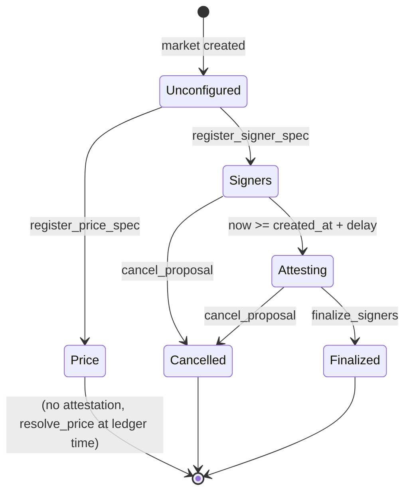

# OracleDesk Protocol Specification — System-Level Invariants and Flows

This document defines system-level invariants (constraints that hold across all contracts), lifecycle state machines, and cross-contract message sequences.

## System Invariants

### SYS-INV-1: Solvency per Market

For every market:
```
balance[market_id] == sets_minted[market_id] + fees_accrued[market_id] + lp_fees[market_id]
```

The contract's own token balance for a market equals the sum of:
- **`sets_minted`** — total YES + NO complete sets ever created (buy, split).
- **`fees_accrued`** — the protocol's accrued share of trading fees, pending sweep to the fee recipient.
- **`lp_fees`** — the creator's accrued share of trading fees, pending claim via `claim_lp_fees` or `claim_pool_remainder`.

Rounding: fee splits use `ceil` for the protocol portion and `floor` for the LP portion, so `protocol + lp == total_fee` exactly.

### SYS-INV-2: Reserve Invariant (YES side, NO symmetric)

For every market:
```
reserve_yes[market_id] + Σ(position[holder].yes for all holders) == sets_minted[market_id]
```

The YES side of the constant-product pool reserves plus the sum of all holder YES positions equals the total sets minted.

### SYS-INV-3: Position Conservation

The sum of all holder positions across all markets equals the total collateral ever pulled from holders minus the total collateral ever paid out (buys, sells, redemptions, merges).

### SYS-INV-4: Fee Monotonicity until Sweep

`fees_accrued[market_id]` can only increase (via trades) or reset to 0 (via `sweep_fees`). It never decreases otherwise.

### SYS-INV-5: Single LP Payout on Claim

A creator can call `claim_pool_remainder(market_id)` and receive their accumulated `lp_fees` plus the pool remainder exactly once. No subsequent call succeeds (the entrypoint checks `already_claimed` state or deletes the entry).

### SYS-INV-6: Resolver Finalizes Once

The resolver transitions a market from `Open` or `Closed` to `Finalized` exactly once, via `resolve_price`, `finalize_signers`, or `guardian_void_market`. After `Finalized`, the market's status never changes.

### SYS-INV-7: Treasury Exposure Monotone per Market

For each treasury-created market, the treasury's cumulative `exposure[agent][market_id]` can only increase via `agent_buy`, or reset to 0 via `close_trade`. It never decreases otherwise, even if the agent redeems early or claims LP fees. This models the treasury's risk model: capital is reserved and never freed until explicitly closed.

### SYS-INV-8: Single Redeem per Market per Holder

After a market is `Finalized` and `Resolved` or `Void`, a holder can call `redeem(market_id)` and receive their settlement value exactly once. No subsequent redeem on the same `(holder, market_id)` pair succeeds (the entry is deleted or state is checked).

### SYS-INV-9: Void Payout is Floor-Divided

In a voided market, each holder receives `floor((yes_i + no_i) / 2)` where `yes_i, no_i` are their position shares, and the pool remainder is distributed similarly. The sum across all holders and the pool may fall short of `sets_minted` by at most `holders_count + 1` units (rounding dust), and that dust remains in the contract (unrecoverable).

## Lifecycle State Machines

### Market Lifecycle

```mermaid
stateDiagram-v2
    [*] --> Open: create_market
    Open --> Closed: close_time reached (automatic, not by entrypoint)
    Open --> Finalized: guardian_void_market
    Closed --> Finalized: resolve_price
    Closed --> Finalized: finalize_signers
    Closed --> Open: (rollback, rare; not in normal path)
    Finalized --> [*]
```



**Notes:**
- `Open` → `Closed` is automatic at ledger time `close_time`; no entrypoint transition.
- After `Finalized`, the market's status is locked and never changes.
- `guardian_void_market` can be called at any time before finality (even while `Open`).

### Resolution State Machine (Resolver)

The resolver tracks per-market proposal state:



**Notes:**
- Each market has exactly one proposal (signer or price).
- `Unconfigured` → `Signers` or `Price` via spec reveal (commit/reveal pattern, see ADR 0001).
- Once `Finalized` or `Cancelled`, no further proposal actions apply to this market.

### Treasury Agent Exposure (per market)

```mermaid
stateDiagram-v2
    [*] --> Active: agent_create_market or agent_buy (increases exposure)
    Active --> Active: agent_buy (further increases exposure)
    Active --> Closed: close_trade (exposure remains; not freed)
    Closed --> [*]
```



**Notes:**
- Exposure is cumulative and never decreases (SYS-INV-7).
- `close_trade` marks the market as closed in the treasury's risk ledger but does not free the exposure cap.
- Each market has a per-agent cumulative exposure; exceeding `max_trade` per market is an error on `agent_buy`.

## Cross-Contract Message Sequences

### Sequence 1: Treasury Agent Market Creation with Bounty (Issue #149)

```
Agent (or keeper)
  │
  ├─ treasury.agent_create_market_with_bounty(
  │      agent_addr,
  │      seed_amount,
  │      bounty_amount,
  │      question_hash,
  │      resolution_hash,
  │      close_time,
  │      ...
  │  )
  │      │ (pre-auth two transfers in one authorize_as_current_contract)
  │      ├─ transfer(treasury → market_core, seed_amount)
  │      └─ transfer(treasury → resolver, bounty_amount)
  │      │
  │      ├─ market_core.create_market(...)
  │      │      └─ [creates market entry, sets reserves]
  │      │
  │      ├─ resolver.fund_bounty(treasury, market_id, bounty_amount)
  │      │      └─ [creates BountyEscrow entry]
  │      │
  │      └─ treasury.reserve_capacity(seed_amount + bounty_amount)
  │             └─ [updates exposure; checks against caps]
  │
  └─ [Response: market_id]
```

**Invariants:** SYS-INV-1 (solvency), SYS-INV-7 (exposure).

### Sequence 2: Market Trading and Fee Accumulation

```
Trader
  │
  ├─ market_core.buy(trader, market_id, outcome, collateral, min_shares_out)
  │      │
  │      ├─ [check not paused, market exists, is open, now < close_time]
  │      ├─ [calculate FPMM price]
  │      ├─ [split and accrue fees; updates reserve_*, fees_accrued]
  │      ├─ [transfer(trader → market_core, collateral)]
  │      │
  │      └─ [emit Trade event]
  │
  └─ [repeated for multiple trades]

Keeper (permissionless)
  │
  └─ market_core.sweep_fees(market_id)
         │
         ├─ [check market exists, fees_accrued > 0]
         ├─ [transfer(market_core → current fee_recipient, fees_accrued)]
         └─ [emit FeesSwept event]
```

**Invariants:** SYS-INV-1, SYS-INV-2, SYS-INV-4.

### Sequence 3: Resolution with Bounty Payout (Issue #149)

```
Keeper (or permissionless caller)
  │
  ├─ market_core close_time reached
  │      └─ [market status becomes Closed]
  │
  ├─ resolver.register_signer_spec(market_id, spec)
  │      └─ [validates resolution hash; enables attestation]
  │
  ├─ [signers attest or timeout passes]
  │
  └─ resolver.finalize_signers_for(caller, market_id)
         │
         ├─ [check: market is closed, proposal finalized, auth(caller)]
         ├─ market_core.resolve(market_id, outcome)
         │      │
         │      ├─ [set market status = Finalized]
         │      └─ [set outcome]
         │
         └─ resolver.pay_bounty(market_id, caller)
                └─ [transfer escrow if paid=false, set paid=true, emit BountyPaid]

Holder
  │
  └─ market_core.redeem(holder, market_id)
         └─ [transfer settlement value based on outcome]
```

**Invariants:** SYS-INV-1, SYS-INV-6, SYS-INV-8.

### Sequence 4: Outcome Token Wrapping (Issue #146)

```
Holder
  │
  ├─ outcome-token-factory.wrap(holder, market_id, outcome, amount)
  │      │
  │      ├─ [deploy token contract if needed (deterministic address)]
  │      ├─ [pre-auth transfer_position in nested call]
  │      │
  │      ├─ market_core.transfer_position(holder, token_addr, market_id, outcome, amount)
  │      │      └─ [move amount shares from holder → token contract's position]
  │      │
  │      └─ outcome-token.mint(holder, amount)
  │             └─ [credit holder with outcome-token]
  │
  └─ [Holder now has outcome-token; original position reduced]

Holder
  │
  └─ outcome-token.transfer(holder, recipient, amount)
         └─ [transfer token; recipient's position in outcome-token contract increases]

[After market resolution]

Holder
  │
  └─ outcome-token.redeem_wrapped(holder)
         │
         ├─ outcome-token.settle([outcome])
         │      │
         │      ├─ market_core.redeem(token_addr, market_id)
         │      │      └─ [token receives settlement based on outcome: 1:1 / 0.5 floor / 0]
         │      │
         │      └─ [cache settlement value and supply]
         │
         └─ outcome-token.burn_and_pay(holder)
                └─ [burn holder's tokens; pay pro-rata settlement]
```

**Invariants:** SYS-INV-1, SYS-INV-2 (modified per outcome token), SYS-INV-8.

### Sequence 5: Void Market with Bounty Refund (Issue #149)

```
Admin
  │
  └─ resolver.guardian_void_market(market_id)
         │
         ├─ market_core.void_market(market_id)
         │      │
         │      ├─ [set status = Void]
         │      └─ [emit MarketVoided]
         │
         └─ resolver.refund_bounty(market_id)
                └─ [transfer bounty escrow back to funder, set paid=true]

Holder
  │
  └─ market_core.redeem(holder, market_id)
         └─ [transfer void settlement: (yes + no) / 2 floor, per SYS-INV-9]
```

**Invariants:** SYS-INV-6, SYS-INV-9.

## Trust Assumptions

1. **Admin keys.** The resolver, market-core, and treasury are initialized with an `Admin` address. Only the `Admin` can:
   - Change protocol parameters (`set_paused`, `set_default_fee_bps`, `set_resolver`, etc.).
   - Void markets (resolver).
   - Transfer admin status to a new address.
   - The admin is assumed to be a `timelock` or multisig contract (documented in ADR 0008).

2. **Oracle identity.** Resolution via price requires a Reflector oracle contract at a known address. The oracle's answers are trusted; oracle compromise is out of scope (assumed: Stellar Foundation responsibility).

3. **Collateral token.** All markets use a single collateral SEP-41 token (e.g., USDC). The token's `transfer` logic is assumed to be correct.

4. **Signer set authenticity.** Resolution via signers requires the resolver to trust that a signer set was authentically chosen for a given market. The resolver stores signers on a per-market basis and does not verify their liveness or authenticity; that is the responsibility of the market creator (via the `register_signer_spec` commit/reveal).

5. **Reasoner oracle** (reasoning-registry only). The registry allows an `Admin` to register `Reasoner` addresses. All registered reasoners are equally trusted; the registry does not verify that a reasoner's reasoning is correct, only that traces published under that reasoner are tamper-proof (the hash and signature are verified on `verify_trace`).

## See Also

- `docs/spec/market-core.md` — market-core entrypoints and error handling.
- `docs/spec/resolver.md` — resolver state machine and authentication.
- `docs/spec/treasury.md` — treasury risk model and exposure ledger.
- `docs/spec/reasoning-registry.md` — trace storage and verification.
- `docs/adr/0001-resolution-commitment.md` — commit/reveal pattern.
- `docs/adr/0002-cross-contract-calls.md` — vendored WASM and contractimport!.
